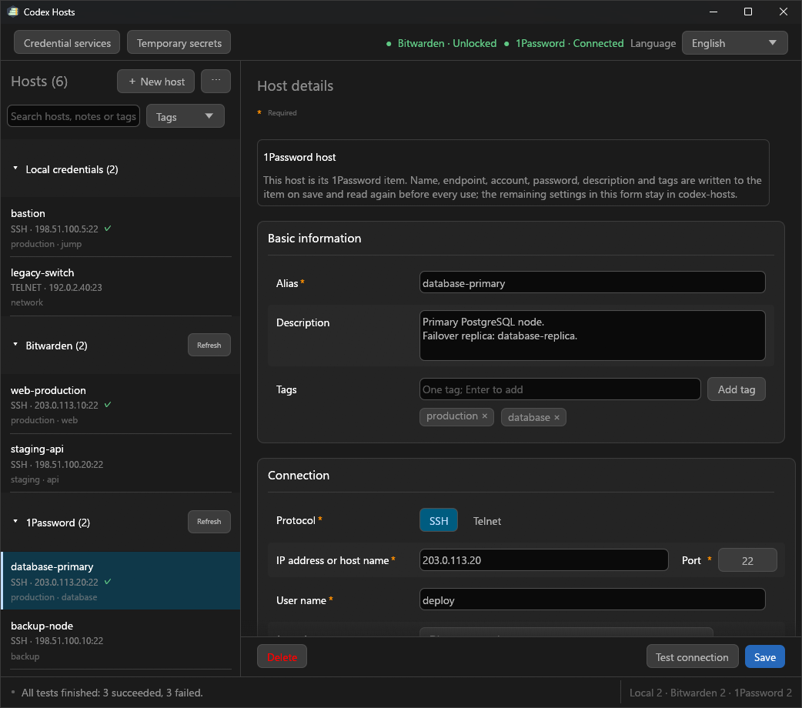

<h1 align="center">codex-hosts</h1>

<p align="center">Your saved hosts. Your credentials. Codex at work.</p>

<p align="center">
  <a href="https://github.com/Torinomii/codex-hosts/tree/v0.3.3"></a>
  <a href="https://github.com/Torinomii/codex-hosts/actions/workflows/release.yml"></a>
  <a href="LICENSE"></a>
  
  <a href="https://linux.do/"></a>
</p>

<p align="center">
  <a href="README.md">English</a> · <a href="docs/readme/README_zh-CN.md">简体中文</a> · <a href="docs/readme/README_zh-TW.md">繁體中文</a> · <a href="docs/readme/README_ja.md">日本語</a>
</p>

<p align="center">
  <a href="https://github.com/Torinomii/codex-hosts/releases">Download</a> · <a href="#installation">Installation</a> · <a href="#quick-start">Quick start</a> · <a href="#release-history">Release history</a> · <a href="#technical-reference">Technical reference</a>
</p>

A Windows SSH / Telnet host manager and MCP server for Codex. Save a host once, then ask Codex to connect, run commands or work across several machines. Passwords, private-key passphrases and FIDO PINs are collected locally and kept out of the conversation and tool parameters.

<p align="center">
  
</p>

## At a glance

| Capability | What you can do |
| --- | --- |
| Host management | Save SSH / Telnet profiles with descriptions and tags; search, filter, import and export them. |
| Authentication | Use passwords, OpenSSH private keys, FIDO / YubiKey handles, Windows OpenSSH Agent or Pageant. |
| Remote commands | Run a command, send text over stdin, or select an execution user explicitly with sudo / su. |
| Parallel work | Run several commands over one SSH connection, or probe and execute across an explicit host list. |
| Connections | Verify host keys and jump chains; choose per-call authentication, session reuse or an idle timeout. |
| Call approval | Review complete SSH commands and waiting batches; set approval separately for each temporary-secret field. |
| Temporary secrets | Keep API keys and tokens in process memory and inject them into a chosen local program's environment. |

## What's new in 0.3.3

- **Sudo / su:** Choose an execution user and pass an absolute program with exact arguments. Saved-password supply is separately authorized; passwordless paths work with it off.
- **SSH call approval:** Review full commands, inputs and batches before each call. Retained connections never reuse an approval.
- **Temporary secrets:** Approval is enabled per field by default. Saving or clearing a field revokes waiting runs.
- **Editor and credentials:** Optional account passwords stay collapsed and account-bound. Changing a login cannot transfer or expose another account's saved password.
- **Guided installation:** Install the complete Skill through symbolic links, with environment checks, confirmed replacements and backups.

[Compare changes](https://github.com/Torinomii/codex-hosts/compare/v0.3.2...v0.3.3)

## Installation

Choose a prebuilt package for the shortest setup, or build from a stable source checkout. Both install the complete Skill through symbolic links.

| Route | Requirements | Entry point |
| --- | --- | --- |
| GitHub Release | 64-bit Windows 10+ · PowerShell 7.2+ | `install.cmd` or the command below |
| Source checkout | The above + Rust 1.92+, MSVC and Windows SDK | `scripts/install.cmd` or `scripts/install-local-skill.ps1` |

### 1. Install the package

Download `codex-hosts-windows-x86_64.zip` from the [Releases page](https://github.com/Torinomii/codex-hosts/releases), extract it to a stable directory, and run its installer:

```powershell
pwsh -NoProfile -File .\install-local-skill.ps1 -ReleasePackage
```

The ZIP includes the program, the complete Skill and both `install-local-skill.ps1` and `install.cmd`. Double-click `install.cmd` for the same guided flow; it tells you if PowerShell 7.2+ is missing. Release installation does not need Rust or Visual Studio. After environment checks, confirm the installation path and any proposed replacement of an old copy, stale link or executable path.

Releases after 0.3.1 also carry `codex-hosts-windows-x86_64.zip.sha256`; compare it with `(Get-FileHash .\codex-hosts-windows-x86_64.zip).Hash` before extracting.

**Keep the extracted directory or checkout in place.** The installed Skill links to it, and Windows must allow symbolic-link creation for the current user. Install the whole package, including its references and executable.

### 2. Register the MCP server

Add this once to `%USERPROFILE%\.codex\config.toml` (or your workspace's `.codex\config.toml`), replacing `<user>` with your Windows account name:

```toml
[mcp_servers.codex-hosts]
command = "C:\\Users\\<user>\\.codex\\skills\\codex-hosts\\bin\\codex-hosts.exe"
args = ["--mcp"]
startup_timeout_sec = 20
tool_timeout_sec = 86400
```

<details>
<summary><strong>Build from source or link an existing checkout</strong></summary>

### Build from source

```powershell
pwsh -NoProfile -File .\scripts\install-local-skill.ps1
```

The recommended entry point is `pwsh -NoProfile -File .\scripts\install-local-skill.ps1` (or `scripts\install.cmd`). It checks PowerShell 7.2+, Rust 1.92+, the x86_64 MSVC toolchain and Windows SDK, then asks whether to compile and whether to install symbolic links. Missing tools are explained, not installed automatically. A guided build writes `target\x86_64-pc-windows-msvc\release\codex-hosts.exe`.

You can still compile manually with Rust 1.92+ and the MSVC toolchain:

```powershell
git clone https://github.com/Torinomii/codex-hosts.git
cd codex-hosts
cargo build --locked --release
```

The executable is created at:

```text
target\release\codex-hosts.exe
```

After a manual build, run the linked installation command below with `-SkipBuild`; it prefers an existing guided build, then falls back to `target\release\codex-hosts.exe`.

### Link a local source checkout

When developing from a stable local checkout, install symbolic links instead of copying after every build:

```powershell
pwsh -NoProfile -File .\scripts\install-local-skill.ps1 -SkipBuild
```

The script links the installed `codex-hosts` directory to `skill\codex-hosts` as one unit. The source Skill's `bin\codex-hosts.exe` links to the selected build, so rebuilding that target updates the executable without copying. It shows old/new paths and asks before replacing copied files/directories, wrong links or dangling links. Old contents remain in adjacent `.codex-hosts.backup-*` paths; a failed installation attempts to restore both links. Correct links are left unchanged. Keep the checkout or extracted package in place; after moving it, rerun the script and confirm the new targets.

Windows must allow symbolic-link creation. If the check fails, enable Developer Mode yourself or run an elevated PowerShell, then retry. The script never changes system settings, stops applications or falls back to copying. If a running executable is locked, close it yourself when convenient before rebuilding.

</details>

<details>
<summary><strong>Installer options and Skill layout</strong></summary>

The installed Skill has this layout:

```text
%USERPROFILE%\.codex\skills\codex-hosts\
├── SKILL.md
├── bin\
│   └── codex-hosts.exe
├── agents\
└── references\
```

Use `-CodexHome <directory>` to override `CODEX_HOME` / `%USERPROFILE%\.codex` (for example, `-CodexHome "$env:USERPROFILE\.agents"` installs under `.agents\skills`). Automation can use `-NonInteractive -Build -Install`, or `-NonInteractive -SkipBuild -Install` with an existing build; replacement additionally requires `-ReplaceExisting`. `-SkipInstall` builds without installing. Without explicit approval, prompts default to No.

The same installer also supports a retained, locally prepared distribution ZIP with `-ReleasePackage`.

You can also ask Codex to install it:

```text
Clone https://github.com/Torinomii/codex-hosts.git to a stable directory and run scripts/install-local-skill.ps1. Let it check the build environment, then ask me before compiling, installing links or replacing old paths.
Confirm that the installed codex-hosts Skill directory is one symbolic link and its executable resolves to the release build; register the codex-hosts MCP server in config.toml as described in SKILL.md, and keep the checkout in place.
```

</details>

## Quick start

### 1. Add a host

Open `codex-hosts.exe`, create a host, and enter its alias, address, port, user, protocol and authentication method. Add a description or tags if useful, then save.

### 2. Choose an authentication method

| Method | Description |
| --- | --- |
| Password | Password authentication, stored in Windows Credential Manager |
| OpenSSH Key | Ordinary OpenSSH private-key file |
| FIDO / Security Key | OpenSSH FIDO handle backed by a hardware device |
| SSH Agent | Identity already loaded in Windows OpenSSH Agent or Pageant |

Sensitive authentication values are not passed through the Codex conversation.

### 3. Use the host from Codex

Tell Codex the saved alias and the task. For example:

```text
Connect to example and run hostname.
Check disk usage on web-1 and web-2.
Connect to server1 and check hostname, uptime, and disk space.
```

The Skill looks up the host, verifies its key, authenticates and returns structured command results. Normal use does not require calling MCP tools manually.

## Security boundaries

| Control | Behaviour |
| --- | --- |
| Login credentials | Passwords and key passphrases stay in Windows Credential Manager; FIDO PINs are never saved. |
| Host identity | Unknown or changed SSH fingerprints require your confirmation, including each jump hop. |
| Retained connections | Reusing a session skips later authentication and key touches. Call approval is a separate setting. |
| Sudo / su | Choose the user on each call. Saved-password supply has independent permissions and handles only the outer authentication. |
| Temporary secrets | Memory only, with approval enabled per field by default; closing the tray application clears the values. |

> **Telnet has no encryption.** Credentials, commands and results may cross the network in plaintext. Use it only on trusted networks where you accept that risk; prefer SSH for Internet connections.

<details>
<summary><strong>Credential storage, host trust, session persistence and temporary secrets</strong></summary>

### Login credentials

Passwords and private-key passphrases are persistently stored in Windows Credential Manager.

These sensitive values are not:

- Written into host profiles
- Placed in MCP tool parameters or results
- Passed as command-line arguments
- Returned to Codex

A FIDO PIN is used only for the current operation and is not saved.

The host store (`hosts.json`) must be owned by the Windows account running `codex-hosts`. The MCP server refuses to start when another account owns it and prints the `icacls /setowner` command that repairs it to stderr (visible in Codex's MCP log); the GUI only warns. This catches a store copied from another account, not an attacker who already runs as you.

### SSH host keys

SSH host fingerprints require explicit user confirmation.

On a first connection to an unknown host, `codex-hosts` displays the detected host fingerprint. It is saved only after the user confirms it.

If the server host key later changes, the saved fingerprint is not replaced automatically and must be confirmed again.

### Authentication persistence

Hosts from earlier versions and imported hosts re-authenticate on every Codex call, so a hardware key is touched once per action and Codex never holds an open session between calls. A new host is proposed with **Keep for the Codex session**; the editor asks you to confirm the choice on the first save and again whenever you change it, in either direction. Each host can pick any option in its **Authentication** card:

| Option | Behaviour |
| --- | --- |
| Re-authenticate on every operation | The connection closes when the call ends. Hosts from earlier versions and imports start here. |
| Keep for the Codex session | Proposed for new hosts. The authenticated session stays open, with keepalives, until Codex exits, the link drops, or `disconnect` is called. |
| Disconnect after idle time | The session stays open until it has been idle for the chosen number of minutes. |

While a session is kept, later Codex commands on that host run without re-authenticating or touching the security key, which removes the one-confirmation-per-action protection. The editor shows this warning, hosts that keep sessions carry a marker in the list, and Codex is told never to suggest changing the setting. Telnet hosts always re-authenticate. Credentials, PINs and host-key checks are unaffected; only the live session is reused.

### Temporary secrets

`codex-hosts` can also hold temporary API keys, tokens, and other sensitive values unrelated to host login.

These values live only in the current `codex-hosts` process memory. They are not stored in Windows Credential Manager and are not returned to Codex.

Each field has a Call approval checkbox matching the main interface, enabled by default. Field names, masked values and approval controls share aligned columns; narrow windows stack them. If any field used by a program requires approval, a blue dialog inside the temporary-secret editor asks before injecting the values into its environment. Its top buttons decide only this run; clicking the command opens full details with paged text and full-text copying. Back or Escape in details makes no decision. Switching off approval for all referenced fields allows direct execution.

**Delete all** asks for confirmation before removing every field, saved value and unsaved draft. Waiting operations are cancelled; running programs are not stopped. Per-field Clear and `temporary_secrets_clear` still clear values without removing fields.

They expire when the `codex-hosts` tray application exits, the user signs out, or the system restarts. Codex starting or stopping does not affect them.

See [`temporary-secrets.md`](skill/codex-hosts/references/temporary-secrets.md) for the complete behavior.

</details>

## Release history

Expand a release for its complete changes. The current 0.3.3 highlights are above.

<details>
<summary><strong>0.3.3 · Sudo / su, call approval and guided installation</strong></summary>

- **Sudo / su:** `exec_sudo` and `exec_su` run an absolute program with exact arguments as an explicitly chosen user. Their independent Advanced switches authorize saved-password supply; passwordless execution still works with them off. Passwords stay bound to their accounts and never enter tool parameters.
- **Editor:** sudo/su use the same form rows and checkboxes as other Advanced options. Optional account passwords are collapsed by default; login fields are not duplicated, and no execution target or dedicated sudo/su test is saved. Changing an account never transfers its saved password to another user.
- **Call approval:** an optional per-host switch asks before each SSH call, including probes, user switches and batches. Blue dialogs show exact commands and inputs, full details, expiry and decision feedback; bulk buttons apply only to the displayed batch, and retained connections never reuse approval.
- **Temporary secrets:** each field has its own approval switch, enabled by default. A run needs approval if any referenced field requires it; otherwise it starts directly or waits for the current local child to finish. Saving or clearing fields revokes waiting runs.
- **Skill:** updated sudo/su and authorization-dialog guidance, including passwordless paths, explicit execution users and failure handling. Ordinary commands and script-internal sudo/su do not gain transparent password supply.
- **Credential safety:** login-password records rotate when the account changes, so in-flight sudo/su calls cannot read another account's new password. Legacy migration removes the old slot, and deletion clears it too.
- **Installation:** source and Release installs now use symbolic links only. The step-by-step script checks the environment, asks before compiling/installing, and offers to update old copies or wrong links with backups.

[Compare changes](https://github.com/Torinomii/codex-hosts/compare/v0.3.2...v0.3.3)

</details>

<details>
<summary><strong>0.3.2 · Complete Skill directory linking</strong></summary>

- **Complete directory link:** the installed `codex-hosts` Skill now links to the entire source Skill directory, keeping `SKILL.md`, `agents` and `references` together. Its executable has a separate link inside the source Skill.
- **Windows build preparation:** added the `winresource` build dependency and updated the package to 0.3.2.

[Compare changes](https://github.com/Torinomii/codex-hosts/compare/v0.3.1...v0.3.2)

</details>

<details>
<summary><strong>0.3.1 · MCP tools, session persistence and connection reliability</strong></summary>

- **MCP server:** `codex-hosts.exe --mcp` serves Codex over stdio. Hosts, probes, commands, batches, the host editor and temporary secrets are MCP tools with risk annotations; no shell, PowerShell wrapper or temporary request files are involved any more. The previous file-based tool mode keeps working unchanged for Skills that have not been updated.
- **Authentication persistence:** every host now chooses whether Codex keeps the session for the Codex session (proposed for new hosts; the choice is confirmed on the first save and whenever it changes), re-authenticates on every operation (the previous behaviour, kept for hosts from earlier versions and for imports), or drops it after a chosen idle time. Hosts that keep sessions are marked in the list and carry a warning in the editor.
- **Editor:** required fields are marked with `*` and highlighted when a save is attempted with one empty; a new **Advanced** card holds per-host tuning (concurrent channels, default timeouts, keepalive interval, a remote-environment hint for Codex, hiding a host from Codex, and Telnet prompt overrides).
- Cancelling a Codex call now stops the wait and closes the channel; long-running work is documented around the remote host's own `tmux` / `screen` instead of long waits.
- `codex-hosts.exe --version` prints the version, and argument errors are reported on stderr. The executable is a windowed program, so both are visible only when captured (`codex-hosts.exe --version | more`).
- **Connection reliability:** improved real Telnet login prompts and echo handling, SSH jump-hop cleanup, profile-change handling and retained-session idle timing.
- **Diagnostics:** MCP results carry the version; failed credential reads do not make the whole host list unusable. MCP startup checks the host-store owner.
- **Release delivery:** Actions validates and packages the executable, complete Skill, link installers and a SHA-256 checksum.

[Compare changes](https://github.com/Torinomii/codex-hosts/compare/v0.3.0...v0.3.1)

</details>

<details>
<summary><strong>0.3.0 · Host manager redesign, descriptions and tags</strong></summary>

- **Host descriptions and tags:** search and filter the list by notes or tags, and let Codex prefill them (`--description`, `--tag`). `list_hosts` returns both fields and accepts a `tags` filter, and `exec` accepts `stdin` for command input.
- **Redesigned window:** a resizable host list with a compact header, host details grouped into Basic information / Connection / Authentication / SSH host key cards, and a fixed action bar for Test connection and Save.
- **Status bar and notifications:** every outcome is shown in the bottom status bar, and warnings or errors also appear as a dismissible notice in the top-right corner.
- **Batch management:** a selection bar with the selected count, Select all, Export and Delete appears below the toolbar; rows get checkboxes and `Esc` leaves the mode.
- Import and export now open as dialogs that must be closed before continuing; all confirmation dialogs share one layout, with destructive actions highlighted.
- **Layout adapts to the window size:** the form uses two columns from 1040 px wide and stacks labels above fields at the minimum window size; light and dark Windows themes are both supported.

[Compare changes](https://github.com/Torinomii/codex-hosts/compare/v0.2.3...v0.3.0)

</details>

## Technical reference

<details>
<summary><strong>MCP tools</strong></summary>

Codex talks to `codex-hosts.exe --mcp` over stdio. Every tool returns the same JSON as `structuredContent` and as text, and carries MCP annotations so a policy layer can tell read-only tools from ones that execute code.

| Tool | Purpose |
| --- | --- |
| `list_hosts` | Saved hosts with non-secret details, trust state, `auth_persistence`, `require_call_approval`, sudo/su supply permissions, `max_channels`, `remote_env` |
| `agent_identities`, `fido_identities` | Public identity details of loaded Agent keys and FIDO handles |
| `probe`, `batch_probe` | Authenticate and run `hostname`; surface unknown or changed host keys |
| `exec`, `exec_stdin`, `exec_many`, `batch_exec` | Run commands; `exec_stdin` is separate because program text on stdin is opaque to review |
| `exec_sudo` | Execute an absolute program with argv as the explicitly selected `user` on an SSH host; ordinary sudo uses the current user's SSH login password when supply is allowed |
| `exec_su` | Execute an absolute program as the explicitly selected target `user`; passwords are optional when the remote policy allows |
| `disconnect` | Drop sessions kept for hosts that opted in |
| `open_host_editor` | Open the editor window prefilled with non-secret details, or to confirm a reported host key |
| `temporary_secrets_open`, `_status`, `_run`, `_clear` | Memory-only secrets held by the tray application |

Parameters never contain a password, passphrase, or PIN; the editor collects those in masked fields. Timeouts (`connect_timeout_ms`, `command_timeout_ms`, `batch_timeout_ms`) are per call and default to 120 s to connect and 10 minutes per command, or to the host's own defaults from its Advanced card.

**Approve each Codex call** in Advanced settings defaults off for SSH hosts. When enabled on a target or jump host, a blue dialog reviews the call's hosts and commands before connecting. One approval covers that Codex call from launch to completion, including all its batch hosts and commands; the next call asks again, even on a retained connection. Top **Allow all / Reject all** buttons decide only the currently displayed batch of waiting calls. Later requests wait for **View next batch**. Click a command for full details, with separate execution and jump hosts, exact commands, stdin, and sudo user when applicable; its top buttons decide that entire call. Long text supports paging and full-text copying. Back or Escape in details makes no decision. The dialog shows counts, an expiry countdown, and decision feedback. Allow buttons are red and reject buttons white.

SSH call approval, temporary-secret approval and sudo/su password supply are independent. Waiting reviews expire after five minutes; approval feedback does not mean the command succeeded. See [approvals.md](skill/codex-hosts/references/approvals.md) for dialog behavior and failure handling.

**Allow saved passwords for sudo** in **Advanced** authorizes automatic saved-password supply. Passwordless or cached authentication works with the switch off; a password request then returns `SUDO_AUTO_AUTH_DISABLED` without reading or sending a password for that request. Codex must choose the execution user on each call: `exec_sudo` requires `alias`, an absolute `program` and `user`, with optional exact `args` and timeouts. To execute as root, pass `"user":"root"`. There is no saved default target. The sudo/su switches use the same rows and checkboxes as other options. Password logins reuse the SSH login password without another login row. Key/Agent logins, or accounts with an existing override, can expand **Separate system password (optional)** when supply is enabled. **Other account passwords (optional)** manages additional accounts. Key/Agent credentials and another user's login password are never substituted. `rootpw`, `targetpw` and `runaspw` use the actual authentication prompt's username. Blank keeps a saved password; removing a separate password still permits eligible login-password reuse. Renaming deletes the old secret and permits an optional replacement. There are no dedicated sudo/su save-and-test buttons; ordinary connection testing is unchanged. No raw command, password, business stdin or automatic retry is accepted. See [sudo.md](skill/codex-hosts/references/sudo.md) for the shell-launcher and TTY/PAM limits.

**Allow saved passwords for su** in **Advanced** authorizes password supply independently of sudo; passwordless execution works with this switch off, while a password request returns `SU_AUTO_AUTH_DISABLED`. `exec_su` likewise requires a per-call `user`, absolute `program`, and optional exact `args` and timeouts. Optional target-user passwords are managed in the collapsed **Other account passwords** area, one user per row. The same account password can be used for su when su supply is allowed; login credentials need not be entered twice. Remote passwordless paths, including root-to-user when allowed, require no record and never load/send a password. Requires util-linux `/usr/bin/su`, `/usr/bin/env`, `/bin/sh` and the standard Linux-PAM prompt, without PTY or business stdin. Old JSON defaults are ignored while saved password slots remain; older calls omitting `user` fail without execution. See [su.md](skill/codex-hosts/references/su.md).

These tools handle only the outer sudo/su authentication. Ordinary `exec` / `exec_stdin` and sudo/su inside an already-started script do not receive automatic password supply; an inner failure does not trigger elevation of the whole script or automatic replay.

Authentication arguments to `open_host_editor` use stable names: `password`; `private-key` / `private_key` for an ordinary private-key file or a FIDO handle (`fido-handle` is also accepted); `ssh-agent` / `ssh_agent` for Windows OpenSSH Agent or Pageant.

When running remote commands, check `output_truncated` to see whether output was shortened by the size limit.

See [`SKILL.md`](skill/codex-hosts/SKILL.md) for the full Codex behavior, workflow, and safety rules.

</details>

<details>
<summary><strong>Command concurrency and multi-host examples</strong></summary>

### Multiple commands on one SSH host

`exec_many` reuses one SSH connection to run several independent short commands concurrently:

```json
{
  "alias": "example",
  "commands": [
    "hostname",
    "uptime",
    "df -h"
  ],
  "max_concurrency": 8
}
```

It authenticates once and then opens multiple channels over the same SSH connection.

This is especially useful with FIDO / security keys because a group of commands can normally share one authentication.

`exec_many` is available only for SSH hosts.

### Multiple hosts

Specify the hosts explicitly:

```json
{
  "aliases": [
    "web-1",
    "web-2",
    "web-3"
  ],
  "command": "uptime",
  "max_concurrency": 8,
  "batch_timeout_ms": 30000
}
```

Hosts can also be probed in a batch:

```json
{
  "aliases": [
    "web-1",
    "web-2"
  ],
  "max_concurrency": 8,
  "batch_timeout_ms": 30000
}
```

Batch mode requires an explicit host list. An empty list is never interpreted as all hosts.

</details>

<details>
<summary><strong>Descriptions, tags, CSV and stdin</strong></summary>

Hosts can store a multiline `description` and multiple `tags`. Add/remove tags in the editor; surrounding whitespace, empty tags and case-insensitive duplicates are removed, preserving the first spelling. Saving only metadata preserves connection verification and host-key trust. Search matches alias, address, username, notes and tags; selecting multiple tag filters requires all of them. Batch select-all applies only to visible hosts, and changing filters drops hidden selections.

`list_hosts` includes both fields and accepts an optional `tags` array. Missing/empty filters return all hosts; unknown tags return no matches. `open_host_editor` prefills `description` and `tags`. Omitted fields preserve saved metadata; an empty description or a sole empty tag clears that field. CSV templates/import/export include optional `description` and `tags` columns; the tags cell is a JSON array such as `["prod","web"]` (CSV quoting applies). Legacy stores and CSV files remain supported.

```json
{"tags":["prod","web"]}
{"alias":"example","command":"python3 -","stdin":"print('hello')\n","command_timeout_ms":10000}
```

`exec_stdin` sends exact UTF-8 text, up to 1 MiB, to a single SSH host's command without adding a newline, then EOF; `""` sends EOF immediately. Input and output progress concurrently under the existing deadlines and output limits. A remote program can still exit before consuming all input; its exit status remains authoritative. Oversized input returns `STDIN_TOO_LARGE`; Telnet hosts return `STDIN_UNSUPPORTED`. No command is automatically replayed.

</details>

<details>
<summary><strong>Timeouts, probe approval and long-running commands</strong></summary>

`tool_timeout_sec` is only a ceiling; each call carries its own timeout, which must stay below it. With Codex's default (300 s), a command that outlives it keeps running until its own timeout (10 minutes unless set), and later calls to that host wait for it unless the host keeps its session.

`probe` and `batch_probe` are marked read-only and run `hostname`, but still connect and authenticate; a hardware key may require a touch. The host's call-approval setting also applies to probes. To request an additional Codex-side confirmation, use:

```toml
[mcp_servers.codex-hosts.tools.probe]
approval_mode = "prompt"

[mcp_servers.codex-hosts.tools.batch_probe]
approval_mode = "prompt"
```

Command execution is deliberately bounded to prevent excessive output or memory use.

- A single command can capture at most **1 MiB** of output.
- A complete `exec_many` or batch JSON result is limited to **8 MiB**.
- `exec_many` and batch operations use bounded concurrency.
- Check `output_truncated` when output may have been shortened.
- Remote commands are not automatically retried after network failures.
- Cancelling a Codex call closes the channel and returns `CANCELLED`; a remote command that already started may keep running.
- Work that takes more than a few minutes belongs in the remote host's `tmux` / `screen`; see [`long-running.md`](skill/codex-hosts/references/long-running.md).

Automatic retries are avoided because remote commands may not be idempotent, for example:

```text
reboot
rm
systemctl restart
database writes
deployment operations
```

A network failure does not mean that running the same command again is safe.

</details>

<details>
<summary><strong>FIDO / security keys and SSH Agent</strong></summary>

`codex-hosts` can use existing OpenSSH ECDSA-SK and Ed25519-SK FIDO handles.

For example:

```text
id_ecdsa_sk
id_ed25519_sk
```

New or recovered FIDO SSH credentials created through the application use ECDSA-SK.

In FIDO mode:

- Hardware private keys stay on the security device.
- The FIDO PIN is used only for the current operation and is not saved.
- SSH Agent is not required.
- Agent forwarding is always disabled.
- Authentication may require a PIN or touch, depending on the device configuration.

FIDO handles and SSH Agent are separate authentication paths.

FIDO handle:

```text
codex-hosts
    │
    ▼
OpenSSH FIDO Handle
    │
    ▼
Security key
```

`codex-hosts` performs hardware signing directly through system components.

SSH Agent:

```text
codex-hosts
    │
    ▼
OpenSSH Agent / Pageant
    │
    ▼
Loaded identity
```

Authentication is delegated to an already running Agent.

`codex-hosts` does not start, enable, or persist an Agent service automatically.

</details>

<details>
<summary><strong>SSH jump-host chains</strong></summary>

An SSH host can use another saved and verified SSH host as a jump host.

For example:

```text
Codex
  │
  ▼
jump-1
  │
  ▼
jump-2
  │
  ▼
target
```

Rules:

- A jump host must be a verified SSH host.
- Every hop verifies its host key.
- Jump-host loops are rejected.
- An SSH chain can contain at most 8 hosts.
- Agent forwarding is always disabled.

</details>

<details>
<summary><strong>Project structure</strong></summary>

```text
codex-hosts
├── src\
├── skill\
│   └── codex-hosts\
│       ├── SKILL.md
│       ├── agents\
│       └── references\
├── languages\
├── docs\
│   └── readme\
│       ├── README_zh-CN.md
│       ├── README_zh-TW.md
│       └── README_ja.md
├── Cargo.toml
├── Cargo.lock
├── Main.png
└── README.md
```

</details>

## License

This project is licensed under the [Apache License 2.0](LICENSE).
