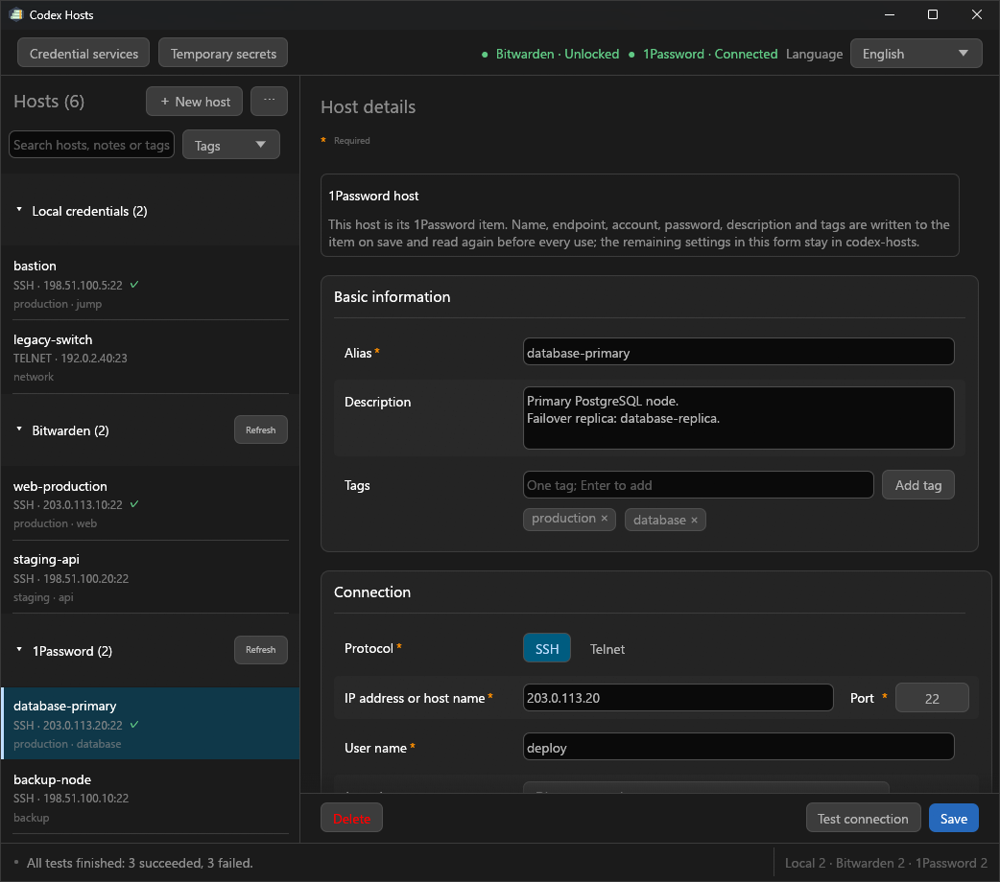

<h1 align="center">codex-hosts</h1>

<p align="center">保存したホストへ。資格情報は手元に。作業は Codex に。</p>

<p align="center">
  <a href="https://github.com/Torinomii/codex-hosts/tree/v0.4.0"></a>
  <a href="https://github.com/Torinomii/codex-hosts/actions/workflows/release.yml"></a>
  <a href="../../LICENSE"></a>
  
  <a href="https://linux.do/"></a>
</p>

<p align="center">
  <a href="../../README.md">English</a> · <a href="README_zh-CN.md">简体中文</a> · <a href="README_zh-TW.md">繁體中文</a> · <a href="README_ja.md">日本語</a>
</p>

<p align="center">
  <a href="https://github.com/Torinomii/codex-hosts/releases">ダウンロード</a> · <a href="#インストール">インストール</a> · <a href="#クイックスタート">クイックスタート</a> · <a href="#リリース履歴">リリース履歴</a> · <a href="#技術リファレンス">技術リファレンス</a>
</p>

Codex 向けの Windows SSH / Telnet ホスト管理ツール兼 MCP サーバーです。ホストをローカル、または Bitwarden や 1Password の保管庫に保存すれば、接続、コマンド実行、複数マシンでの作業を Codex に依頼できます。パスワード、秘密鍵のパスフレーズ、FIDO PIN はローカルで入力し、会話やツール引数には含めません。

<p align="center">
  
</p>

## 機能一覧

| 機能 | できること |
| --- | --- |
| ホスト管理 | 説明やタグ付きの SSH / Telnet 設定を保存し、検索、絞り込み、インポート、エクスポート。 |
| 資格情報サービス | ホストのログインを Windows 資格情報マネージャー、Bitwarden のフォルダー、1Password の保管庫に保存。サービスごとに一覧のセクション、設定ウィザード、ツールバーの状態表示があります。 |
| 認証方式 | パスワード、OpenSSH 秘密鍵、FIDO / YubiKey、Windows OpenSSH Agent、Pageant に対応。 |
| リモートコマンド | コマンド実行、stdin へのテキスト送信、sudo / su での実行ユーザーの明示的な指定。 |
| 並行・バッチ実行 | 1 本の SSH 接続で複数コマンドを実行、または明示したホスト一覧で疎通確認・実行。 |
| 接続の管理 | ホスト鍵と踏み台チェーンを検証し、毎回の再認証、セッション保持、アイドル切断を選択。 |
| 呼び出し承認 | 完全な SSH コマンドと待機バッチを確認し、一時シークレットの承認をフィールドごとに設定。 |
| 一時シークレット | API Key や Token をプロセスメモリに保持し、指定したローカルプログラムの環境変数に注入。 |

## 0.4.0 の主な変更点

- **Bitwarden ホスト：** Bitwarden の 1 つのフォルダーにあるログインアイテムがホストになります（アイテム名 = エイリアス、`ssh://` / `telnet://` URI = 接続先、ユーザー名とパスワード = ログイン）。使うたびに公式 `bw` CLI で読み直すため、保管庫での変更は次の呼び出しから反映されます。
- **1Password ホスト：** 1Password の 1 つの保管庫にあるログインアイテムがホストになります。公式 `op` CLI と 1Password デスクトップアプリ経由で読み取り、アプリが codex-hosts の許可を求めます。
- **設定ウィザード：** Bitwarden は CLI、サーバー、新しいデバイスの確認を含むログイン、フォルダーを順に設定。1Password は `op.exe` を自動検索し、承認画面が出る前に説明して、保管庫を選択または作成します。
- **すべてのサービスで共通のホスト管理：** ローカル、Bitwarden、1Password のホストが一覧、エディター、ダイアログを共有します。保管庫ホストの保存や削除はアイテムに書き込みます（1Password のアイテムはアーカイブ）。ツールバーに各サービスの状態、ステータスバーにサービスごとのホスト数を表示します。
- **1 回の呼び出しに 1 つのダイアログ：** 承認が必要な呼び出しで Bitwarden 保管庫がロックされていれば、承認ダイアログ内でマスターパスワードを求めます。sudo と su はアイテムから読んだログインパスワードを再利用します。
- **エディター：** 未保存の編集を破棄する前に確認し、「変更を元に戻す」と「削除」を表示。パスワード欄に表示切り替えを追加し、取り消し履歴を残しません。

[変更を比較](https://github.com/Torinomii/codex-hosts/compare/v0.3.3...v0.4.0)

## インストール

ビルド済みパッケージで手早く導入するか、固定パスのソースからビルドできます。どちらもシンボリックリンクで完全な Skill をインストールします。

| 方法 | 必要な環境 | 開始方法 |
| --- | --- | --- |
| GitHub Release | 64 ビット Windows 10+、PowerShell 7.2+ | `install.cmd` または以下のコマンド |
| ソースからビルド | 上記 + Rust 1.92+、MSVC、Windows SDK | `scripts/install.cmd` または `scripts/install-local-skill.ps1` |

### 1. プログラムと Skill をインストール

[Releases ページ](https://github.com/Torinomii/codex-hosts/releases)から `codex-hosts-windows-x86_64.zip` をダウンロードし、固定ディレクトリに展開してから、そのディレクトリで次を実行します：

```powershell
pwsh -NoProfile -File .\install-local-skill.ps1 -ReleasePackage
```

ZIP にはプログラム、完全な Skill、`install-local-skill.ps1` と `install.cmd` が含まれます。`install.cmd` をダブルクリックしても同じ手順が始まり、PowerShell 7.2+ がない場合は導入方法を表示します。Release のインストールに Rust や Visual Studio は不要です。環境確認後にインストール先を確認し、旧コピー、古いリンク、誤った実行ファイルのパスがあれば更新を確認します。

0.3.1 より後の Release には `codex-hosts-windows-x86_64.zip.sha256` も添付されます。展開前に `(Get-FileHash .\codex-hosts-windows-x86_64.zip).Hash` と照合してください。

**展開先またはチェックアウトをそのまま保持してください。** インストール先の Skill はそこへのリンクです。現在の Windows ユーザーにシンボリックリンクの作成権限が必要で、参考文書と実行ファイルを含む完全なパッケージを保持します。

### 2. MCP サーバーを登録

`%USERPROFILE%\.codex\config.toml`（またはワークスペースの `.codex\config.toml`）に一度追加し、`<user>` を Windows アカウント名に置き換えます：

```toml
[mcp_servers.codex-hosts]
command = "C:\\Users\\<user>\\.codex\\skills\\codex-hosts\\bin\\codex-hosts.exe"
args = ["--mcp"]
startup_timeout_sec = 20
tool_timeout_sec = 86400
```

<details>
<summary><strong>ソースからビルド、または既存のチェックアウトをリンク</strong></summary>

### ソースからビルド

```powershell
pwsh -NoProfile -File .\scripts\install-local-skill.ps1
```

推奨する入口は `pwsh -NoProfile -File .\scripts\install-local-skill.ps1`（または `scripts\install.cmd`）です。PowerShell 7.2+、Rust 1.92+、x86_64 MSVC ツールチェーン、Windows SDK を確認し、ビルド開始とシンボリックリンクのインストールを順に質問します。不足するツールの案内は表示しますが、自動導入はしません。この手順のビルド先は `target\x86_64-pc-windows-msvc\release\codex-hosts.exe` です。

Rust 1.92+ と MSVC ツールチェーンで手動ビルドすることもできます：

```powershell
git clone https://github.com/Torinomii/codex-hosts.git
cd codex-hosts
cargo build --locked --release
```

生成される実行ファイル：

```text
target\release\codex-hosts.exe
```

手動ビルド後は、以下のリンク用コマンドに `-SkipBuild` を指定します。スクリプトによるビルド済みファイルを優先し、なければ `target\release\codex-hosts.exe` を使います。

### ローカルソースチェックアウトをリンクする

固定パスのローカルチェックアウトで開発する場合は、ビルドのたびにコピーせず、シンボリックリンクでインストールできます。

```powershell
pwsh -NoProfile -File .\scripts\install-local-skill.ps1 -SkipBuild
```

スクリプトはインストール先の `codex-hosts` 全体を `skill\codex-hosts` にリンクし、その中の `bin\codex-hosts.exe` を選択したビルドにリンクします。同じターゲットの再ビルド後にコピーは不要です。コピー形式のファイル/ディレクトリ、誤ったリンク、リンク切れを検出すると旧・新パスを表示して確認します。旧内容は隣接する `.codex-hosts.backup-*` に保持し、失敗時は両方のリンクの復元を試みます。正しいリンクは変更しません。ソースまたは展開先を保持し、移動後は再実行して新しいパスを確認してください。

Windows でシンボリックリンクの作成が許可されている必要があります。確認に失敗したら、自分で開発者モードを有効にするか、管理者の PowerShell で再実行してください。スクリプトはシステム設定の変更、アプリの終了、コピーへの切り替えを行いません。実行中のファイルがロックされている場合は、都合のよい時に自分で終了してからビルドしてください。

</details>

<details>
<summary><strong>インストールオプションと Skill の構成</strong></summary>

インストール後の Skill の構成：

```text
%USERPROFILE%\.codex\skills\codex-hosts\
├── SKILL.md
├── bin\
│   └── codex-hosts.exe
├── agents\
└── references\
```

`-CodexHome <ディレクトリ>` で `CODEX_HOME` / `%USERPROFILE%\.codex` を変更できます（例：`-CodexHome "$env:USERPROFILE\.agents"` は `.agents\skills` にインストール）。自動化には `-NonInteractive -Build -Install`、ビルド済みなら `-NonInteractive -SkipBuild -Install` を使います。旧内容の置き換えには別途 `-ReplaceExisting` が必要です。`-SkipInstall` はビルドだけを行い、明示的な承認のない質問は既定で No です。

ローカルで作成した配布 ZIP を展開した場合も、同じスクリプトを `-ReleasePackage` 付きで使い、展開先を保持してください。

Codex にインストールを依頼することもできます：

```text
https://github.com/Torinomii/codex-hosts.git を固定ディレクトリにクローンし、scripts/install-local-skill.ps1 でビルド環境を確認してください。ビルド、リンクのインストール、旧パスの置き換えはそれぞれ実行前に私に確認してください。
インストール先の codex-hosts Skill ディレクトリ全体が単一のシンボリックリンクで、実行ファイルがリリースビルドを参照することを確認し、SKILL.md に従って config.toml に codex-hosts MCP サーバーを登録し、チェックアウトを保持してください。
```

</details>

## クイックスタート

### 1. ホストを追加

`codex-hosts.exe` を開いて「ホストを追加」を選び、エイリアス、アドレス、ポート、ユーザー名、プロトコル、認証方式を入力します。必要に応じて説明やタグを追加し、保存します。パスワードマネージャーを設定すると、同じメニューから Bitwarden や 1Password のホストも作成できます。

### 2. 認証方式を選択

| 認証方式 | 説明 |
| --- | --- |
| Password | パスワード認証。パスワードは Windows 資格情報マネージャーに保存 |
| OpenSSH Key | 通常の OpenSSH 秘密鍵ファイルを使用 |
| FIDO / セキュリティキー | OpenSSH FIDO Handle を使用し、ハードウェア側で署名 |
| SSH Agent | Windows OpenSSH Agent または Pageant に読み込まれている ID を使用 |

これらの認証方式で使う機密値は Codex の会話を経由しません。

### 3. 任意：Bitwarden または 1Password にホストを置く

ツールバーの「資格情報サービス」を開き、サービスの「設定を開始…」を選びます。ウィザードが公式 CLI を確認してアカウントを接続すると、ホスト一覧にそのサービスのセクションが、ツールバーに状態が表示されます。

| サービス | 必要なもの | ホストになるもの |
| --- | --- | --- |
| Bitwarden | 公式 Bitwarden CLI（`bw.exe`）と、bitwarden.com、bitwarden.eu または独自サーバーのアカウント | 1 つのフォルダーのログインアイテム |
| 1Password | 起動中の 1Password デスクトップアプリ（「設定 › 開発者 › 1Password CLI と連携」をオン）と公式 1Password CLI（`op.exe`） | 1 つの保管庫のログインアイテム。専用の保管庫を推奨 |

### 4. Codex からホストを使う

保存したエイリアスと作業内容を Codex に伝えます。例：

```text
example に接続して hostname を実行してください。
web-1 と web-2 のディスク使用量を確認してください。
server1 に接続して hostname、uptime、ディスク容量を確認してください。
```

Skill がホストの検索、鍵の確認、認証を行い、構造化された実行結果を返します。通常は MCP ツールを手動で呼び出す必要はありません。

## セキュリティ境界

| 制御 | 動作 |
| --- | --- |
| ログイン資格情報 | パスワードと鍵のパスフレーズは Windows 資格情報マネージャー、保管庫ホストでは Bitwarden / 1Password のアイテムに保存し、FIDO PIN は保存しません。 |
| Bitwarden / 1Password | アイテムは使うたびに読み直します。マスターパスワードと新しいデバイスの確認コードはアプリ内でのみ入力し、1Password のロック解除は 1Password アプリだけで行います。 |
| ホストの身元 | 未知または変更された SSH フィンガープリントには確認が必要で、踏み台の各 Hop も検証します。 |
| セッション保持 | 再利用中は後続の認証とキーのタッチを省略します。呼び出し承認は別の設定です。 |
| sudo / su | 呼び出しごとにユーザーを選択。保存パスワードの供給は個別に許可し、外側の認証だけを扱います。 |
| 一時シークレット | メモリ内だけに保持し、各フィールドの承認は初期状態で有効。トレイアプリの終了で値を消去します。 |

> **Telnet は暗号化されません。** 資格情報、コマンド、結果が平文で送信される可能性があります。このリスクを許容できる信頼済みネットワークでのみ使用し、インターネット接続には SSH を優先してください。

<details>
<summary><strong>資格情報、パスワードマネージャー、ホストの信頼、認証保持、一時シークレットの詳細</strong></summary>

### ログイン資格情報

パスワードと秘密鍵ファイルのパスフレーズは Windows 資格情報マネージャーに永続保存されます。

これらの機密値は：

- ホスト設定へ書き込まれません
- MCP ツールのパラメーターや結果に含まれません
- コマンドライン引数として渡されません
- Codex に返されません

FIDO PIN は現在の操作にだけ使用され、保存されません。

### Bitwarden と 1Password のホスト

ホストは資格情報マネージャーの代わりにパスワードマネージャーに置くこともできます。ログインアイテムにはエイリアス、接続先、ユーザー名、パスワード、説明、タグを保存し、その他の設定（認証の保持、呼び出し承認、踏み台、詳細設定）は `codex-hosts` に残ります。アイテムは使うたびに各社の公式 CLI で読み直すため、保管庫での変更は次の呼び出しから反映され、ウィンドウでホストを保存するとアイテムに書き戻します。

- **Bitwarden：** マスターパスワードは `codex-hosts` 自身の入力画面、または承認が必要な呼び出しでは承認ダイアログ内で求めます。「再認証」でセッションキーの保持期間を、毎回、アイドル時間まで、`codex-hosts` を閉じるまで、「ロック」を押すまでから選べます。保持中のキーは Windows 資格情報マネージャーに保存し、終了時は `bw lock` も実行します。
- **1Password：** `codex-hosts` がアカウントのパスワードを見ることはありません。1Password アプリが codex-hosts の許可を求め、Windows Hello またはアカウントのパスワードで確認します。10 分間使わないとき、および少なくとも 12 時間ごとに再度求めます。ホストを削除するとアイテムはアーカイブされます。

### SSH Host Key

SSH ホストのフィンガープリントはユーザーが明示的に確認する必要があります。

未知のホストへ初めて接続すると、`codex-hosts` は実際に検出したホストフィンガープリントを表示します。

ユーザーが確認した後にだけ保存されます。

その後サーバーの Host Key が変更された場合も、保存済みのフィンガープリントを自動で置き換えることはありません。再度ユーザー確認が必要です。

### 認証の保持

旧バージョンのホストとインポートしたホストは Codex の呼び出しごとに再認証するため、ハードウェアキーは操作ごとに一度タッチが必要で、Codex は呼び出しの間にセッションを保持しません。新規ホストでは「Codex セッション中は保持する」が事前選択され、エディターは初回保存時と、その後どちらの方向へ変更した場合にも確認を求めます。各ホストの「認証」カードでどの選択肢でも選べます：

| オプション | 動作 |
| --- | --- |
| 操作ごとに再認証する | 呼び出し終了時に接続を閉じます。旧バージョンのホストとインポートしたホストはここから始まります。 |
| Codex セッション中は保持する | 新規ホストで事前選択。認証済みセッションをキープアライブ付きで開いたままにし、Codex の終了、リンク切断、または `disconnect` の呼び出しまで保持します。 |
| アイドル後に切断する | 指定した分数アイドル状態が続くまでセッションを保持します。 |

セッションを保持している間、そのホストへの Codex の後続コマンドは再認証もセキュリティキーのタッチも求めず、「操作ごとに一度確認する」保護が失われます。エディターはこの警告を表示し、セッションを保持するホストは一覧にマークが付き、Codex にはこの設定の変更を提案しないよう指示しています。Telnet ホストは常に再認証します。資格情報、PIN、ホスト鍵の確認は影響を受けず、再利用されるのは有効なセッションだけです。

### 一時シークレット

`codex-hosts` は、ホストログインとは無関係な API Key、Token などの機密値を一時的に保持することもできます。

これらの値は現在実行中の `codex-hosts` プロセスのメモリ内だけに保持されます。Windows 資格情報マネージャーには保存されず、Codex に返されることもありません。

各フィールドの呼び出し承認はメイン画面と同じチェックボックスで、初期状態ではオンです。フィールド名、マスクされた値、承認を共通の列幅で揃え、狭い画面では縦に並べます。参照するフィールドのうち一つでも承認が有効なら、一時シークレット画面内の青いダイアログで確認します。上部ボタンは今回の実行だけに適用されます。コマンドをクリックすると全詳細を表示し、長文はページ表示と全文コピーに対応します。詳細で戻るか Esc を押しても判断しません。すべて無効なら環境変数へ直接注入して実行できます。

上部の「すべて削除」は確認後に全フィールド、保存値、未保存の入力を削除し、待機中の操作をキャンセルします。実行中のプログラムは停止しません。個別の「消去」と `temporary_secrets_clear` は引き続き値だけを消去し、フィールドを残します。

`codex-hosts` トレイアプリの終了、Windows のサインアウト、またはシステム再起動で一時値は失効します。Codex の起動や終了は影響しません。

詳細は [`temporary-secrets.md`](../../skill/codex-hosts/references/temporary-secrets.md) を参照してください。

</details>

## リリース履歴

バージョンを展開すると変更点の全体を確認できます。現在の 0.4.0 の概要は上部にあります。

<details>
<summary><strong>0.4.0 · Bitwarden と 1Password のホスト</strong></summary>

- **Bitwarden ホスト：** 1 つのフォルダーのログインアイテムがホストです（名前 = エイリアス、`ssh://` / `telnet://` URI = 接続先、ユーザー名とパスワード = ログイン、説明とタグは `codex-hosts:` カスタムフィールド）。公式 `bw` CLI が、指定した期間より古くない同期の後、使うたびにアイテムを読み直します。フォルダーで作成したホストは一覧の更新前でもエイリアスで見つかります。
- **Bitwarden の設定とロック：** ウィザードで CLI、サーバー（bitwarden.com、bitwarden.eu、独自サーバー）、新しいデバイスの確認を含むログイン、フォルダーを設定。「再認証」で保管庫のロック解除を、毎回、アイドル時間まで、ウィンドウを閉じるまで、手動でロックするまでから選べます。保持中のキーは Windows 資格情報マネージャーに保存し、終了時は `bw lock` も実行します。
- **1Password ホスト：** 1 つの保管庫のログインアイテムがホストで、公式 `op` CLI と 1Password デスクトップアプリ経由で読み取ります。ウィザードは `op.exe` を自動検索し（winget、Scoop、Chocolatey、Program Files、PATH）、アプリの承認画面について表示前と表示中に説明し、保管庫を選択または作成します。編集時は先にアイテムのバージョンを確認し、その間に 1Password 側で変更されていれば上書きせず知らせます。
- **共通のホスト管理：** ローカルと保管庫のホストが同じ一覧セクション、エディター、削除ダイアログ、サービスごとのホスト数を使います。「資格情報サービス」ですべてのサービスを一覧でき、設定済みのサービスはツールバーに状態を表示します。ホストとして使えないアイテムは、足りない項目とともにサービスのページに表示します。
- **呼び出し：** 1 回の呼び出しに 1 つのダイアログ。承認が必要で Bitwarden 保管庫がロック中なら、承認ダイアログ内でマスターパスワードを求めます。sudo と su はその呼び出しがアイテムから読んだログインパスワードを再利用します。新しい `BITWARDEN_*` / `ONEPASSWORD_*` エラーコードで、ユーザーが行うべき操作を Codex に伝えます。
- **エディター：** 未保存の編集を破棄する前に確認し、「変更を元に戻す」と「削除」を表示。パスワード欄に表示切り替えを追加し、取り消し履歴を残しません。破壊的操作の確定ボタンは赤い塗りつぶしになりました。
- **Skill と MCP：** `list_hosts` が `credential_source` を返し、説明と Skill に保管庫ホストの確認画面とエラーコードを記載しました。

[変更を比較](https://github.com/Torinomii/codex-hosts/compare/v0.3.3...v0.4.0)

</details>

<details>
<summary><strong>0.3.3 · sudo / su、呼び出し承認、インストール手順</strong></summary>

- **Sudo / su：** `exec_sudo` と `exec_su` が、明示したユーザーとして絶対パスのプログラムと引数をそのまま実行します。「詳細」の独立したスイッチは保存パスワードの供給だけを許可し、オフでもパスワード不要の実行は可能です。パスワードはアカウントに紐付けたまま、ツール引数には含めません。
- **エディター：** sudo/su は他の詳細設定と同じフォーム行とチェックボックスを使用します。任意のアカウントパスワードは初期状態で折り畳み、ログイン入力を重複させません。既定の実行対象や専用の sudo/su 保存テストボタンはありません。アカウントを変更しても保存パスワードを別ユーザーへ引き継ぎません。
- **呼び出し承認：** ホストごとの任意のスイッチで、疎通確認、ユーザー切り替え、バッチを含む SSH 呼び出しごとに確認できます。青いダイアログに完全なコマンド、入力、詳細、期限、判断結果を表示します。一括ボタンは表示中のバッチだけに適用され、接続を保持しても承認は再利用しません。
- **一時シークレット：** 各フィールドに初期状態で有効な承認スイッチを追加しました。参照するフィールドの一つでも承認が必要なら今回の実行を確認し、すべて無効なら直接実行するか、現在のローカル子プロセスの終了を待ちます。フィールドの保存・消去で待機中の実行を取り消します。
- **Skill：** パスワード不要の経路、明示的な実行ユーザー、失敗時の扱いを含め、sudo/su と承認ダイアログの手順を更新しました。通常のコマンドやスクリプト内部の sudo/su に透過的なパスワード供給は行いません。
- **資格情報の安全性：** ログインアカウント変更時にパスワード記録を切り替え、実行中の sudo/su が別アカウントの新しいパスワードを読むことを防ぎます。旧形式からの移行後とパスワード削除時には、移行元の記録も削除します。
- **インストール：** ソースと Release はシンボリックリンクに統一しました。段階的なスクリプトが環境を確認し、ビルドとインストールの前に質問します。旧コピーや誤ったリンクは、確認後にバックアップを残して更新できます。

[変更を比較](https://github.com/Torinomii/codex-hosts/compare/v0.3.2...v0.3.3)

</details>

<details>
<summary><strong>0.3.2 · Skill ディレクトリ全体のリンク</strong></summary>

- **ディレクトリ全体をリンク：** インストール先の `codex-hosts` Skill をソース Skill 全体へのリンクに変更し、`SKILL.md`、`agents`、`references` をまとめて保持します。実行ファイルはソース Skill 内の別のリンクです。
- **Windows ビルドの準備：** `winresource` ビルド依存関係を追加し、パッケージを 0.3.2 に更新しました。

[変更を比較](https://github.com/Torinomii/codex-hosts/compare/v0.3.1...v0.3.2)

</details>

<details>
<summary><strong>0.3.1 · MCP ツール、認証保持、接続の信頼性</strong></summary>

- **MCP サーバー：** `codex-hosts.exe --mcp` が stdio 経由で Codex にサービスを提供します。ホスト、プローブ、コマンド、バッチ、ホストエディター、一時シークレットはすべてリスク注釈付きの MCP ツールになり、シェルや PowerShell ラッパー、一時リクエストファイルは不要になりました。従来のファイル方式の Tool モードはそのまま残り、未更新の Skill でも動作します。
- **認証の保持：** 各ホストで、Codex セッション中はセッションを保持する（新規ホストで事前選択。初回保存時と変更のたびに確認を求めます）か、操作ごとに再認証する（従来の動作。旧バージョンのホストとインポートしたホストはこのまま）か、指定したアイドル時間後に切断するかを選択します。セッションを保持するホストは一覧にマークが付き、エディターに警告が表示されます。
- **エディター：** 必須項目に `*` が付き、未入力のまま保存すると強調表示されます。新しい「詳細」カードには、ホストごとの同時チャネル数、既定タイムアウト、キープアライブ間隔、Codex 向けのリモート環境ヒント、Codex からの非表示、Telnet プロンプトの上書きが含まれます。
- Codex の呼び出しをキャンセルすると待機を停止しチャネルを閉じます。長時間の作業は長い待機ではなく、リモートホスト自身の `tmux` / `screen` を使う手順として文書化しました。
- `codex-hosts.exe --version` がバージョンを表示し、引数エラーは stderr に出力されます。
- **接続の信頼性：** 実際の Telnet ログインプロンプトとエコー、SSH 踏み台の後処理、ホスト設定の変更、保持セッションのアイドル計測を改善しました。
- **診断：** MCP 結果にバージョンを含め、個別の資格情報読み取り失敗でもホスト一覧を利用できます。MCP 起動時にホスト設定ファイルの所有者を確認します。
- **配布：** Actions がプログラム、完全な Skill、リンク用インストーラー、SHA-256 チェックサムを検証してパッケージ化します。

[変更を比較](https://github.com/Torinomii/codex-hosts/compare/v0.3.0...v0.3.1)

</details>

<details>
<summary><strong>0.3.0 · ホスト画面の再設計、説明とタグ</strong></summary>

- **ホストの説明とタグ:** メモやタグで一覧を検索・絞り込みでき、Codex からも `--description`、`--tag` で事前入力できます。`list_hosts` は両フィールドを返し `tags` フィルターを受け付け、`exec` はコマンド入力用の `stdin` を受け付けます。
- **画面の再設計:** 幅を調整できるホスト一覧とコンパクトなヘッダー、「基本情報 / 接続 / 認証 / SSH ホスト鍵」に分かれたホスト詳細、画面下部に固定された「接続テスト」「保存」の操作バー。
- **ステータスバーと通知:** すべての結果を下部のステータスバーに表示し、警告とエラーは右上に閉じられる通知としても表示します。
- **一括管理:** ツールバーの下に選択数、すべて選択、エクスポート、削除を備えた選択バーが表示され、各行にチェックボックスが付きます。`Esc` で終了します。
- インポートとエクスポートはダイアログになり、閉じるまで他の操作はできません。確認ダイアログは共通レイアウトになり、破壊的な操作は強調表示されます。
- **ウィンドウサイズに合わせてレイアウトが変わります:** 幅 1040 px 以上ではフォームが 2 列、最小サイズではラベルがフィールドの上に配置されます。Windows のライト / ダークテーマの両方に対応します。

[変更を比較](https://github.com/Torinomii/codex-hosts/compare/v0.2.3...v0.3.0)

</details>

## 技術リファレンス

<details>
<summary><strong>MCP ツール</strong></summary>

Codex は stdio 経由で `codex-hosts.exe --mcp` と通信します。各ツールは同じ JSON を `structuredContent` とテキストの両方で返し、ポリシー層が読み取り専用ツールとコードを実行するツールを区別できるよう MCP 注釈を持ちます。

| ツール | 用途 |
| --- | --- |
| `list_hosts` | 保存済みホストの非機密情報、`credential_source`、信頼状態、`auth_persistence`、`require_call_approval`、sudo/su のパスワード供給権限、`max_channels`、`remote_env` |
| `agent_identities`、`fido_identities` | 読み込まれた Agent 鍵と FIDO Handle の公開情報 |
| `probe`、`batch_probe` | 認証して `hostname` を実行し、未知または変更されたホスト鍵を明らかにする |
| `exec`、`exec_stdin`、`exec_many`、`batch_exec` | コマンドを実行する。`exec_stdin` は stdin のプログラム本文がレビューに対して不透明なため別ツール |
| `exec_sudo` | SSH ホストで明示した `user` として絶対パスのプログラムと argv を実行。供給を許可した場合、通常の sudo は現在のユーザーの SSH ログインパスワードを再利用 |
| `exec_su` | su で明示した対象 `user` として絶対パスのプログラムを実行。リモートのポリシーが許せばパスワード不要 |
| `disconnect` | セッション保持を選択したホストのために保持している接続を切断する |
| `open_host_editor` | 非機密情報を事前入力したエディターウィンドウを開く、または報告されたホスト鍵を確認する |
| `temporary_secrets_open`、`_status`、`_run`、`_clear` | トレイアプリが保持するメモリ限定シークレット |

パラメーターにパスワード、パスフレーズ、PIN が含まれることはなく、エディターがマスク付き入力欄で受け取ります。タイムアウト（`connect_timeout_ms`、`command_timeout_ms`、`batch_timeout_ms`）は呼び出しごとに指定し、省略時は接続 120 秒、コマンド 10 分、またはホストの「詳細」カードの既定値が使われます。

SSH ホストの「詳細」にある「Codex 呼び出しごとに承認」は初期状態では無効です。接続先または踏み台で有効にすると、接続前に青いダイアログで今回の全ホストとコマンドを確認します。承認は今回の開始から終了まで有効で、次の呼び出しには再承認が必要です。上部の「すべて許可 / すべて拒否」は表示中の待機バッチだけに適用され、後から届いた要求は「次のバッチを見る」で開きます。コマンドをクリックすると実行先と踏み台、全コマンド、標準入力、必要に応じて sudo ユーザーを表示します。詳細の上部ボタンは呼び出し全体に適用され、戻るか Esc を押しても判断しません。長文はページ表示と全文コピーに対応し、件数、承認期限、判断結果も表示します。許可は赤、拒否は白のボタンです。

SSH 呼び出し承認、一時シークレットの承認、sudo/su のパスワード供給権限はそれぞれ独立しています。承認待ちは 5 分で期限切れとなり、許可の表示はコマンドの成功を意味しません。ダイアログの動作と失敗時の扱いは [approvals.md](../../skill/codex-hosts/references/approvals.md) を参照してください。

「詳細」の「sudo で保存パスワードを使用」は保存パスワードの自動供給を許可します。オフでもパスワード不要や認証キャッシュが有効なら実行できます。パスワードが必要な場合は、その認証用パスワードを読み取り・送信せず `SUDO_AUTO_AUTH_DISABLED` を返します。実行ユーザーは Codex が呼び出しごとに選びます。`exec_sudo` は `alias`、絶対パスの `program`、`user` が必須で、`args` とタイムアウトは任意です。root で実行する場合は `"user":"root"` を指定し、対象の既定値は保存しません。sudo/su は他の設定と同じフォーム行とチェックボックスです。パスワードログインでは SSH ログインパスワードを再利用し、入力欄を重複させません。鍵・Agent ログインや既存の個別パスワードがある場合は、供給を許可して「個別のシステムパスワード（任意）」を展開できます。追加のアカウントは「他のアカウントのパスワード（任意）」で管理します。他ユーザーのログインパスワード、鍵のパスフレーズ、Agent 資格情報は代用しません。`rootpw`、`targetpw`、`runaspw` は実際の認証プロンプトのユーザーに従います。空欄は保存済み値を維持します。個別パスワードを削除しても、条件を満たすログインパスワードは使用できます。名前変更は旧パスワードを削除し、新しい値は任意です。専用の sudo/su 保存テストボタンはなく、通常の接続テストは変更しません。生コマンド、パスワード、業務 stdin、自動再試行は受け付けません。shell 起動器と TTY/PAM の制限は [sudo.md](../../skill/codex-hosts/references/sudo.md) を参照してください。

「詳細」の「su で保存パスワードを使用」は su のパスワード供給を独立して許可します。オフでもパスワード不要なら実行できます。パスワードが必要な場合は `SU_AUTO_AUTH_DISABLED` を返します。`exec_su` も呼び出しごとの `user` と絶対パスの `program` が必須で、`args` とタイムアウトは任意です。対象ユーザーの任意のパスワードは折り畳まれた「他のアカウントのパスワード」で 1 行ずつ管理します。su の使用許可があれば同じアカウントの値を使用でき、ログインパスワードの再入力は不要です。リモートが許可する root から一般ユーザーなどへのパスワード不要の経路では記録も不要で、パスワードを読み込み・送信しません。util-linux `/usr/bin/su`、`/usr/bin/env`、`/bin/sh` と標準 Linux-PAM プロンプトが必要で、PTY と業務 stdin は未対応です。旧 JSON の既定対象は無視し、保存パスワードのスロットは維持します。`user` を省略した旧呼び出しは実行前に失敗します。[su.md](../../skill/codex-hosts/references/su.md) を参照してください。

この二つのツールが扱うのは外側の sudo/su 認証だけです。通常の `exec` / `exec_stdin` や、開始済みスクリプト内部の sudo/su へは自動供給しません。内部の失敗を理由にスクリプト全体を昇格したり、自動再実行したりしません。

`open_host_editor` の認証引数は安定した名前を使います：`password`、通常の秘密鍵ファイルまたは FIDO Handle には `private-key` / `private_key`（`fido-handle` も可）、Windows OpenSSH Agent または Pageant には `ssh-agent` / `ssh_agent`。

リモートコマンドを実行したら、サイズ制限で出力が省略されていないか `output_truncated` を確認してください。

Codex の完全な動作、ワークフロー、安全規則は [`SKILL.md`](../../skill/codex-hosts/SKILL.md) を参照してください。

</details>

<details>
<summary><strong>並行実行と複数ホストの例</strong></summary>

### 1 台の SSH ホストで複数コマンド

`exec_many` は 1 本の SSH 接続を再利用し、複数の独立した短いコマンドを並行実行できます：

```json
{
  "alias": "example",
  "commands": [
    "hostname",
    "uptime",
    "df -h"
  ],
  "max_concurrency": 8
}
```

SSH 認証は 1 回だけ行い、その後同じ接続上で複数の Channel を開きます。

FIDO / セキュリティキーでは、複数コマンドが通常 1 回の認証を共有できるため特に有効です。

`exec_many` は SSH ホスト専用です。

### 複数ホストをまとめて実行

対象ホストを明示的に指定できます：

```json
{
  "aliases": [
    "web-1",
    "web-2",
    "web-3"
  ],
  "command": "uptime",
  "max_concurrency": 8,
  "batch_timeout_ms": 30000
}
```

複数ホストの疎通確認もできます：

```json
{
  "aliases": [
    "web-1",
    "web-2"
  ],
  "max_concurrency": 8,
  "batch_timeout_ms": 30000
}
```

バッチモードではホスト一覧を明示的に指定する必要があります。

空の一覧が「全ホスト」として扱われることはありません。

</details>

<details>
<summary><strong>説明、タグ、CSV、stdin</strong></summary>

ホストに複数行の `description` と複数の `tags` を保存できます。編集画面でタグを追加・削除できます。前後の空白、空のタグ、大文字小文字を区別しない重複は除去し、最初の表記を保持します。説明・タグだけの変更では接続確認やホスト鍵の信頼状態は維持されます。検索対象はエイリアス、アドレス、ユーザー名、説明、タグです。複数のタグ条件はすべて一致する必要があります。一括全選択は表示中のホストだけが対象で、フィルター変更時は非表示ホストの選択を解除します。

`list_hosts` は両フィールドを返し、任意の `tags` 配列で絞り込めます。省略または空配列は全ホスト、存在しないタグは空一覧になります。`open_host_editor` は `description` と `tags` を事前入力できます。省略した値は保持し、空の説明や単独の空タグで消去できます。CSV テンプレート・インポート・エクスポートは任意の `description`、`tags` 列に対応します。タグのセルは `["prod","web"]` のような JSON 配列を CSV の規則で引用します。従来の設定と CSV も利用できます。

```json
{"tags":["prod","web"]}
{"alias":"example","command":"python3 -","stdin":"print('hello')\n","command_timeout_ms":10000}
```

`exec_stdin` は単一の SSH ホストのコマンドに最大 1 MiB の UTF-8 テキストを、改行を追加せずそのまま送信し、最後に EOF を送ります。`""` は即座に EOF を送ります。入力送信と出力受信は同時に進み、既存のタイムアウトと出力制限が適用されます。リモートプログラムが全入力を読む前に終了した場合、その終了状態を優先します。入力超過は `STDIN_TOO_LARGE`、Telnet ホストでは `STDIN_UNSUPPORTED` になります。コマンドは自動再実行されません。

</details>

<details>
<summary><strong>タイムアウト、プローブの承認、長時間の作業</strong></summary>

`tool_timeout_sec` は上限にすぎず、各呼び出しは独自のタイムアウトを持ち、それはこの上限より短くなければなりません。Codex の既定値（300 秒）のままだと、それを超えたコマンドは自身のタイムアウト（未指定なら 10 分）まで実行を続け、セッションを保持しないホストへの後続の呼び出しはその終了を待ちます。

`probe` と `batch_probe` は読み取り専用として注釈され、`hostname` を実行しますが、接続と認証は行い、ハードウェアキーのタッチが必要になる場合があります。ホストの呼び出し承認設定も適用されます。Codex 側で追加の確認を求める場合：

```toml
[mcp_servers.codex-hosts.tools.probe]
approval_mode = "prompt"

[mcp_servers.codex-hosts.tools.batch_probe]
approval_mode = "prompt"
```

異常なコマンドによる過剰な出力やメモリ使用を防ぐため、実行には制限があります。

- 1 コマンドで取得できる出力は最大 **1 MiB**。
- 完成した `exec_many` またはバッチ JSON 結果は最大 **8 MiB**。
- `exec_many` とバッチ処理は同時実行数を制限します。
- 出力が省略された場合は `output_truncated` で確認できます。
- ネットワーク障害が発生してもリモートコマンドを自動再実行しません。
- Codex の呼び出しをキャンセルするとチャネルを閉じて `CANCELLED` を返します。すでに開始したリモートコマンドは実行を続ける場合があります。
- 数分を超える作業はリモートホストの `tmux` / `screen` で行ってください。[`long-running.md`](../../skill/codex-hosts/references/long-running.md) を参照。

自動再試行を行わないのは、リモートコマンドが冪等とは限らないためです。例：

```text
reboot
rm
systemctl restart
データベースへの書き込み
デプロイ操作
```

ネットワーク障害が発生しても、同じコマンドをもう一度実行して安全とは限りません。

</details>

<details>
<summary><strong>FIDO / セキュリティキーと SSH Agent</strong></summary>

`codex-hosts` は既存の OpenSSH ECDSA-SK および Ed25519-SK FIDO Handle を利用できます。

例：

```text
id_ecdsa_sk
id_ed25519_sk
```

アプリ内で新しい FIDO SSH 資格情報を作成または復元する場合は ECDSA-SK を使用します。

FIDO モードでは：

- ハードウェア秘密鍵はセキュリティデバイスの外へ出ません。
- FIDO PIN は現在の操作にだけ使用され、保存されません。
- SSH Agent は不要です。
- Agent Forwarding は常に無効です。
- セキュリティキーの設定によっては PIN または Touch が必要です。

FIDO Handle と SSH Agent は別の認証経路です。

FIDO Handle：

```text
codex-hosts
    │
    ▼
OpenSSH FIDO Handle
    │
    ▼
セキュリティキー
```

`codex-hosts` がシステムコンポーネントを通して直接ハードウェア署名を行います。

SSH Agent：

```text
codex-hosts
    │
    ▼
OpenSSH Agent / Pageant
    │
    ▼
読み込み済み ID
```

認証はすでに実行中の Agent に委譲されます。

`codex-hosts` が Agent サービスを自動的に起動、有効化、永続化することはありません。

</details>

<details>
<summary><strong>SSH 踏み台チェーン</strong></summary>

SSH ホストは、保存済みかつ検証済みの別の SSH ホストを Jump Host として利用できます。

例：

```text
Codex
  │
  ▼
jump-1
  │
  ▼
jump-2
  │
  ▼
target
```

セキュリティルール：

- Jump Host は検証済み SSH ホストである必要があります。
- すべての Hop で Host Key を検証します。
- Jump Host チェーンの循環は拒否されます。
- 1 本の SSH チェーンは最大 8 ホストです。
- Agent Forwarding は常に無効です。

</details>

<details>
<summary><strong>プロジェクト構成</strong></summary>

```text
codex-hosts
├── src\
├── skill\
│   └── codex-hosts\
│       ├── SKILL.md
│       ├── agents\
│       └── references\
├── languages\
├── docs\
│   └── readme\
│       ├── README_zh-CN.md
│       ├── README_zh-TW.md
│       └── README_ja.md
├── Cargo.toml
├── Cargo.lock
├── Main.png
└── README.md
```

</details>

## License

本プロジェクトは [Apache License 2.0](../../LICENSE) の下で提供されます。
