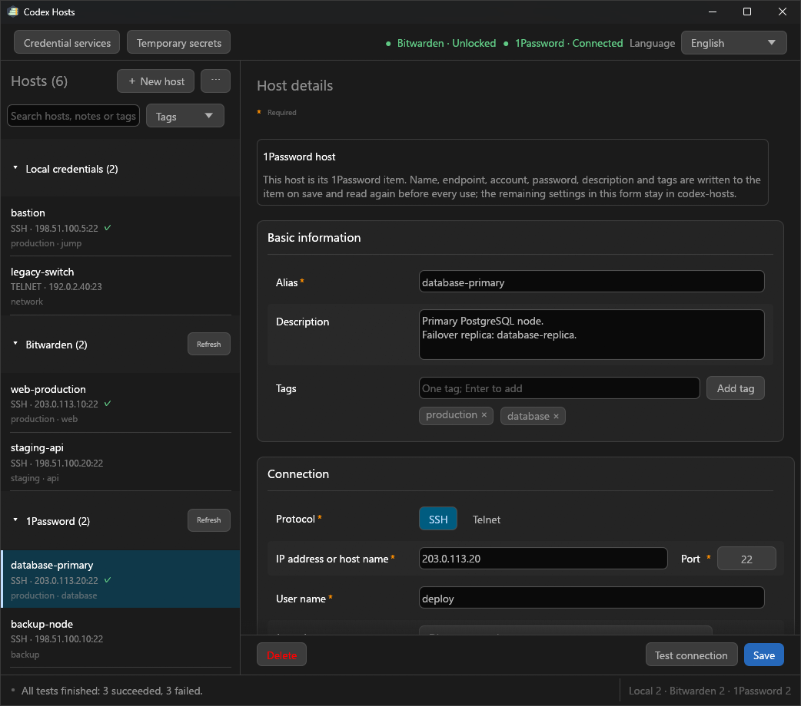

<h1 align="center">codex-hosts</h1>

<p align="center">保存したホストへ。資格情報は手元に。作業は Codex に。</p>

<p align="center">
  <a href="../../Cargo.toml"></a>
  <a href="https://github.com/Torinomii/codex-hosts/actions/workflows/release.yml"></a>
  <a href="../../LICENSE"></a>
  
  <a href="https://linux.do/"></a>
</p>

<p align="center">
  <a href="../../README.md">English</a> · <a href="README_zh-CN.md">简体中文</a> · <a href="README_zh-TW.md">繁體中文</a> · <a href="README_ja.md">日本語</a>
</p>

<p align="center">
  <a href="https://github.com/Torinomii/codex-hosts/releases">ダウンロード</a> · <a href="#インストール">インストール</a> · <a href="#クイックスタート">クイックスタート</a> · <a href="#リリース履歴">リリース履歴</a> · <a href="#技術リファレンス">技術リファレンス</a>
</p>

Codex 向けの Windows SSH / Telnet ホスト管理ツール兼 MCP サーバーです。ホストをローカル、Bitwarden、1Password のいずれかに保存すれば、接続、コマンド実行、複数マシンでの作業を Codex に依頼できます。パスワード、鍵のパスフレーズ、FIDO PIN はローカルで入力し、会話やツール引数には含めません。

<p align="center">
  
</p>

## 機能一覧

| 機能 | できること |
| --- | --- |
| ホスト管理 | 説明やタグ付きの SSH / Telnet ホストを保存し、検索、絞り込み、インポート、エクスポート。 |
| 資格情報の保存先 | ログイン情報を Windows 資格情報マネージャー、Bitwarden のフォルダー、1Password の保管庫に保存。 |
| 認証方式 | パスワード、OpenSSH 秘密鍵、FIDO / YubiKey、Windows OpenSSH Agent、Pageant。 |
| リモートコマンド | コマンド実行、stdin の送信、sudo / su で明示したユーザーとしてプログラムを実行。 |
| 並行・バッチ実行 | 1 本の SSH 接続で複数コマンドを実行、または明示したホスト一覧に対して実行。 |
| 接続の管理 | ホスト鍵と踏み台チェーンを検証。毎回の再認証、セッション保持、アイドル切断を選択。 |
| 呼び出し承認 | SSH の呼び出しを接続前に毎回確認可能。 |
| 一時シークレット | API Key や Token をメモリだけに保持し、ローカルプログラムの環境変数に注入。 |

## 0.4.4 の主な変更点

- 複数のホストを Windows 資格情報マネージャー、Bitwarden、1Password の間でまとめて移動またはコピーできます。
- Codex は保存した API キーやトークンを繰り返し利用できます。保存した値を手動で消去できるのは、一時シークレット画面を操作するユーザーだけです。

## インストール

最も手早いのは Codex に依頼する方法です。次の内容を Codex に貼り付けてください。

```text
https://github.com/Torinomii/codex-hosts/releases/latest から codex-hosts の最新リリースをインストールしてください。codex-hosts-windows-x86_64.zip と codex-hosts-windows-x86_64.zip.sha256 をダウンロードし、チェックサムが一致しなければ中止してください。
インストール先のディレクトリを私に尋ね、インストールされた Skill がそこへリンクするため移動してはいけないことを伝えてください。ZIP をそこに展開して install-local-skill.ps1 -ReleasePackage を実行し、以前のインストールを置き換える前に私に確認してください。
インストールされたスキルのディレクトリが、展開したパッケージの skill/codex-hosts へのシンボリックリンクであることを確認してください。config.toml の [mcp_servers.codex-hosts] に、そのスキル内の bin/codex-hosts.exe の絶対パスを command として登録し、args = ["--mcp"]、startup_timeout_sec = 20、tool_timeout_sec = 86400 を設定してください。
```

Codex が最新の Release をダウンロードして検証し、指定した場所にインストールして MCP サーバーを登録します。コンパイルは行いません。

| 方法 | 必要な環境 | 開始方法 |
| --- | --- | --- |
| Codex に依頼（推奨） | Codex + 「GitHub Release」の環境 | 上のプロンプト |
| GitHub Release | 64 ビット Windows 10+、PowerShell 7.2+ | `install.cmd` または以下のコマンド |
| ソースからビルド | 上記 + Rust 1.92+、MSVC、Windows SDK | `scripts/install.cmd` または `scripts/install-local-skill.ps1` |

**手動でインストールする場合**は、まずパッケージをインストールし、次に MCP サーバーを登録します。

### 1. パッケージをインストール

[Releases ページ](https://github.com/Torinomii/codex-hosts/releases)から `codex-hosts-windows-x86_64.zip` をダウンロードし、同じ場所の `.sha256` と照合してから（`(Get-FileHash .\codex-hosts-windows-x86_64.zip).Hash`）、固定のディレクトリに展開して実行します。

```powershell
pwsh -NoProfile -File .\install-local-skill.ps1 -ReleasePackage
```

`install.cmd` をダブルクリックしても同じ対話式インストーラーが起動します。環境を確認し、以前のインストールを置き換える前に確認を求めます。

**展開したディレクトリは移動しないでください。** インストールされた Skill はそこへのシンボリックリンクのため、現在のユーザーにシンボリックリンクの作成が許可されている必要があります。

### 2. MCP サーバーを登録

`%USERPROFILE%\.codex\config.toml`（またはワークスペースの `.codex\config.toml`）に以下を追加し、`<user>` を Windows のアカウント名に置き換えます。

```toml
[mcp_servers.codex-hosts]
command = "C:\\Users\\<user>\\.codex\\skills\\codex-hosts\\bin\\codex-hosts.exe"
args = ["--mcp"]
startup_timeout_sec = 20
tool_timeout_sec = 86400
```

MCP サーバーは、`hosts.json` の所有者が `codex-hosts` を実行する Windows アカウントまたは Windows の組み込みグループ `BUILTIN\Administrators` であれば起動します。別の所有者が確認された場合は起動を停止し、修復用の `icacls /setowner` コマンドをログに出力します。所有者を確認できない場合は警告を記録して起動を続けます。どちらの場合も、アプリの画面には警告が表示されます。

<details>
<summary><strong>ソースからビルド</strong></summary>

```powershell
git clone https://github.com/Torinomii/codex-hosts.git
cd codex-hosts
pwsh -NoProfile -File .\scripts\install-local-skill.ps1
```

スクリプトは PowerShell、Rust、MSVC ツールチェーン、Windows SDK を確認し、不足があれば説明したうえで、コンパイル前とリンク作成前に確認を求めます。インストールされた Skill は `skill\codex-hosts` に、Skill の `bin\codex-hosts.exe` はビルド結果にリンクされるため、再ビルドするとインストール済みのプログラムも更新されます。置き換えたパスは `.codex-hosts.backup-*` として残ります。

手動でビルドする場合は `cargo build --locked --release --target x86_64-pc-windows-msvc --target-dir target` の後、`-SkipBuild` を付けてインストールします。

シンボリックリンクを作成できない場合は、開発者モードを有効にするか管理者権限の PowerShell を使ってください。スクリプトがシステム設定を変更することはありません。

| オプション | 効果 |
| --- | --- |
| `-CodexHome <directory>` | `CODEX_HOME` / `%USERPROFILE%\.codex` の代わりに別の Codex ホームへインストール |
| `-NonInteractive -Build -Install` | 無人でビルドとインストール。以前のインストールを置き換えるには `-ReplaceExisting` を追加 |
| `-SkipBuild` / `-SkipInstall` | 既存のビルドを使用 / ビルドのみ |

</details>

## クイックスタート

### 1. ホストの保存先を選ぶ（ローカル、Bitwarden、1Password）

`codex-hosts.exe` を開きます。ローカルにはそのまま保存できます。Bitwarden または 1Password に保存する場合は、「資格情報サービス」で使いたいサービスの「設定を開始…」を選びます。

| 保存先 | 必要なもの | ホスト情報の保存場所 |
| --- | --- | --- |
| ローカル（既定） | Windows 標準機能 | ホスト設定は `hosts.json`、保存したログインパスワードは Windows 資格情報マネージャー |
| Bitwarden | 公式 Bitwarden CLI（`bw.exe`）、bitwarden.com、bitwarden.eu または独自サーバーのアカウント | 1 つのフォルダーのログインアイテム |
| 1Password | 「設定 › 開発者 › 1Password CLI と連携」をオンにした 1Password デスクトップアプリと公式 1Password CLI（`op.exe`） | 1 つの保管庫のログインアイテム。専用の保管庫を推奨 |

<details>
<summary><strong>保存先の間でホストを移動・コピーする</strong></summary>

ホストを右クリックし、**移動先** または **コピー先** から保存先を選びます。複数のホストを扱う場合は、**一括管理** で対象を選び、**移動/コピー…** を選択します。

ログインパスワードは保存先から保存先へ直接渡され、鍵のパスフレーズ、sudo と su のパスワード、ホスト鍵の信頼、詳細設定も引き継がれます。ホスト名はすべての保存先で一意のため、コピーの名前は `<エイリアス>-copy` になります。移動では、コピーの保存後に元のホストを削除し、Bitwarden / 1Password の元アイテムはゴミ箱またはアーカイブへ移ります。

移動・コピー先に同じ名前のホスト、または同じ接続先とユーザーのホストがある場合はダイアログに表示され、**スキップ**（既定。どちらも変更しない）、**上書き**（既存のホストに書き込む。移動では名前も引き継ぎ、このホストにパスワードがなければ既存のパスワードを残す）、**両方残す**（名前の末尾に番号を付けて追加）から選べます。**一括管理 › 削除** でも、Bitwarden / 1Password のホストのアイテムはゴミ箱またはアーカイブへ移ります。

Bitwarden / 1Password のホストはそのログインアイテムそのものです。エイリアス、接続先、ユーザー名、パスワード、説明、タグはアイテムに、その他の設定は `codex-hosts` に保存されます。ウィンドウでホストを保存するとアイテムに書き込み、削除すると Bitwarden のアイテムはゴミ箱へ、1Password のアイテムはアーカイブへ移るため、どちらも復元できます。保管庫側でその間に変更されたアイテムを上書きすることはありません。

保管庫への書き込みをキャンセルした場合やタイムアウトした場合は、一部の変更が保存されていることがあります。再試行する前に保管庫を更新して結果を確認してください。

</details>

### 2. ホストを追加

「ホストを追加」を選びます。保管庫を設定済みの場合は、ここで保存先を選びます。エイリアス、アドレス、ポート、ユーザー名、プロトコル、認証方式を入力して保存します。

| 認証方式 | 使うもの |
| --- | --- |
| Password | Windows 資格情報マネージャー、または Bitwarden / 1Password のアイテムに保存したパスワード |
| OpenSSH Key | OpenSSH 秘密鍵ファイル |
| FIDO / セキュリティキー | ハードウェアキー上の OpenSSH FIDO Handle |
| SSH Agent | Windows OpenSSH Agent または Pageant に読み込まれた ID |

### 3. Codex からホストを使う

保存したエイリアスと作業内容を伝えます。

```text
example に接続して hostname を実行して。
web-1 と web-2 のディスク使用量を確認して。
```

Skill がホストを調べ、ホスト鍵を検証して認証し、構造化された結果を返します。MCP ツールを自分で呼び出す必要はありません。

## セキュリティ境界

| 制御 | 動作 |
| --- | --- |
| ログイン資格情報 | Windows 資格情報マネージャー、またはホストの Bitwarden / 1Password アイテムに保存。ホスト設定、ツール引数、コマンドライン、結果には含めません。FIDO PIN は保存しません。 |
| パスワードマネージャー | Bitwarden のマスターパスワードは `codex-hosts` 内でのみ入力し、1Password のロック解除は 1Password アプリだけで行います。 |
| ホストの身元 | 未知または変更された SSH ホスト鍵には確認が必要で、踏み台の各 Hop も同様です。 |
| セッション保持 | 保持中のセッションでは後続の認証とキーのタッチを省略します。呼び出し承認は別の設定です。 |
| sudo / su | 実行ユーザーは呼び出しごとに指定。保存パスワードの供給には個別の許可が必要です。 |
| 一時シークレット | メモリ内だけに保持し、初期状態でフィールドごとに承認が必要。トレイアプリの終了で消去します。 |

> **Telnet は暗号化されません。** 資格情報、コマンド、出力が平文で送信される可能性があります。信頼できるネットワークでのみ使用し、SSH を優先してください。

<details>
<summary><strong>ログイン情報の保存とキャッシュ</strong></summary>

ローカルホストのパスワードと鍵のパスフレーズは、サインイン中の Windows アカウントの資格情報マネージャーに保存します。FIDO PIN はその操作の間だけ使います。

Bitwarden では再びロック解除を求めるタイミングを設定できます。セッションを保持すると、その鍵は Windows 資格情報マネージャーに保存されます。1Password のロック解除と許可の有効期間は、1Password デスクトップアプリが管理します。

保管庫のホスト情報とログインパスワードはメモリにキャッシュされます。既定の有効期間は最後にキャッシュを利用してから 60 分です。**資格情報サービス › ログイン情報のキャッシュ** ではサービスごとに有効期間を変更でき、0 にすると無効になります。その場で消去することもできます。Bitwarden の設定が「毎回」の場合はログイン情報をキャッシュしません。1Password をロックしたり、アプリの外でアイテムを変更したりしても、キャッシュが失効するか手動で消去するまでは以前のログイン情報が返ることがあります。

</details>

<details>
<summary><strong>ホスト鍵と認証の保持</strong></summary>

初回接続時、`codex-hosts` はサーバーのホスト鍵フィンガープリントを表示し、確認後にのみ保存します。変更された鍵が自動で置き換えられることはありません。

各ホストの「認証」カードで、Codex が認証済みセッションを保持する期間を選びます。

| オプション | 動作 |
| --- | --- |
| 操作ごとに再認証する | 呼び出し終了時に接続を閉じます。旧バージョンのホストとインポートしたホストはこの設定です。 |
| Codex セッション中は保持する | 新規ホストで提案される設定。Codex の終了、リンク切断、または `disconnect` の呼び出しまで保持します。 |
| アイドル後に切断する | 指定した分数アイドルが続くとセッションを閉じます。 |

セッションを保持している間、そのホストの後続コマンドは再認証もセキュリティキーのタッチもなしに実行されます。エディターは初回保存時と変更時にこの選択の確認を求め、該当するホストは一覧に印が付きます。Telnet ホストは常に再認証します。

</details>

<details>
<summary><strong>一時シークレット</strong></summary>

`codex-hosts` はホストのログインとは無関係な API Key や Token などの値も保持できます。値は `codex-hosts` のプロセスメモリだけに置かれ、Codex には返されず、Codex が実行するローカルプログラムの環境変数に注入されます。

各フィールドは初期状態で承認が必要で、それを使うプログラムの起動前にダイアログで確認します。フィールドごと、またはウィンドウ全体のスイッチですべてのフィールドの承認をまとめてオフにすると直接実行できます（全体スイッチは後から追加するフィールドにも適用され、再起動後も保持されます。オフにする前に確認があります）。値はトレイアプリの終了、サインアウト、Windows の再起動で失効し、Codex の再起動では消えません。

詳細は [`temporary-secrets.md`](../../skill/codex-hosts/references/temporary-secrets.md) を参照してください。

</details>

## リリース履歴

<details>
<summary><strong>0.4.0 · Bitwarden と 1Password のホスト</strong></summary>

- **Bitwarden ホスト：** 1 つのフォルダーのログインアイテムがホストになり、説明とタグは `codex-hosts:` カスタムフィールドに保存されます。使うたびに、指定した期間より古くない同期の後で公式 `bw` CLI がアイテムを読み直し、フォルダーで作成したホストはすぐにエイリアスで見つかります。
- **Bitwarden のロック解除：** 保管庫のロック解除を保つ期間を選択（毎回、アイドル時間、終了まで、ロックするまで）。bitwarden.com、bitwarden.eu、独自サーバー、新しいデバイスの確認に対応。
- **1Password ホスト：** 1 つの保管庫のログインアイテムがホストになり、公式 `op` CLI と 1Password デスクトップアプリ経由で読み取ります。設定時に `op.exe` を自動検索し、保管庫の作成もできます。
- **編集：** 保管庫ホストもローカルホストと同じエディターで作成、編集、削除できます。保管庫側で同時に変更された場合は上書きせずに知らせます。
- **Codex：** `list_hosts` が `credential_source` を返し、新しい `BITWARDEN_*` / `ONEPASSWORD_*` エラーコードでユーザーが行うべき操作を伝えます。sudo と su はアイテムから読んだパスワードを再利用します。

[変更を比較](https://github.com/Torinomii/codex-hosts/compare/v0.3.3...v0.4.0)

</details>

<details>
<summary><strong>0.3.3 · sudo / su、呼び出し承認、インストール手順</strong></summary>

- **sudo / su：** `exec_sudo` と `exec_su` が、明示したユーザーとして絶対パスのプログラムを正確な引数で実行。詳細設定の個別スイッチで保存パスワードの供給を許可し、オフでもパスワード不要の実行は可能です。
- **呼び出し承認：** ホストごとの任意スイッチで、疎通確認、ユーザー切り替え、バッチを含む各 SSH 呼び出しを接続前に確認。保持中の接続でも承認は再利用しません。
- **一時シークレット：** フィールドごとの承認スイッチ（初期状態でオン）と、すべてを切り替える全体スイッチ。保存や消去で待機中の実行を取り消します。
- **資格情報の安全性：** 保存パスワードはアカウントに紐づき、ログインを変更しても別アカウントのパスワードを引き継ぎません。
- **インストール：** Release とソースのどちらもシンボリックリンクのみでインストールし、環境確認とバックアップ付きの対話式スクリプトを使います。

[変更を比較](https://github.com/Torinomii/codex-hosts/compare/v0.3.2...v0.3.3)

</details>

<details>
<summary><strong>0.3.2 · Skill ディレクトリ全体のリンク</strong></summary>

- インストールされた `codex-hosts` Skill がソースの Skill ディレクトリ全体にリンクし、`SKILL.md`、`agents`、`references` をまとめて扱います。

[変更を比較](https://github.com/Torinomii/codex-hosts/compare/v0.3.1...v0.3.2)

</details>

<details>
<summary><strong>0.3.1 · MCP ツール、認証保持、接続の信頼性</strong></summary>

- **MCP サーバー：** `codex-hosts.exe --mcp` が stdio で Codex に応答し、すべてのツールにリスク注釈を付けます。従来のファイル経由のツールモードも引き続き動作します。
- **認証の保持：** ホストごとに、呼び出しごとの再認証、Codex セッション中の保持、アイドル後の切断を選択。
- **エディター：** 必須項目を表示し、「詳細」カードでホストごとの調整（チャネル数、タイムアウト、キープアライブ、リモート環境、Codex からの非表示、Telnet プロンプト）が可能に。
- Codex の呼び出しをキャンセルするとチャネルを閉じます。長時間の作業はリモートホストの `tmux` / `screen` で行います。
- Telnet ログイン、踏み台の後処理、アイドル計時の信頼性を改善。Release に SHA-256 チェックサムを同梱。

[変更を比較](https://github.com/Torinomii/codex-hosts/compare/v0.3.0...v0.3.1)

</details>

<details>
<summary><strong>0.3.0 · ホスト画面の再設計、説明とタグ</strong></summary>

- **説明とタグ：** メモやタグで検索・絞り込み。`list_hosts` が両方を返して `tags` で絞り込み、`exec` が `stdin` を受け付けます。
- **画面の再設計：** サイズ変更できるホスト一覧、グループ化されたホスト詳細、ステータスバーと通知、一括選択、ライト / ダークテーマ。

[変更を比較](https://github.com/Torinomii/codex-hosts/compare/v0.2.3...v0.3.0)

</details>

## 技術リファレンス

<details>
<summary><strong>MCP ツール</strong></summary>

すべてのツールは同じ JSON を `structuredContent` とテキストの両方で返し、読み取り専用かコードを実行するかを示す MCP 注釈を持ちます。

| ツール | 用途 |
| --- | --- |
| `list_hosts` | 保存済みホストの非機密情報、`credential_source`、信頼状態、`auth_persistence`、`require_call_approval`、sudo/su の権限、`max_channels`、`remote_env` |
| `agent_identities`、`fido_identities` | 読み込まれた Agent 鍵と FIDO Handle の公開情報 |
| `probe`、`batch_probe` | 認証して `hostname` を実行し、未知または変更されたホスト鍵を報告 |
| `exec`、`exec_stdin`、`exec_many`、`batch_exec` | コマンドを実行します。標準入力を渡すには `exec_stdin` を使います。コマンドの自動審査ルールでは、任意の標準入力の意味を判断できません。SSH 呼び出しの承認が有効な場合は、承認ダイアログで入力の全文を確認できます。 |
| `exec_sudo`、`exec_su` | 呼び出しごとに指定した `user` として、絶対パスのプログラムを正確な引数で実行 |
| `disconnect` | 保持中のセッションを切断 |
| `open_host_editor` | 非機密情報を入力済みのエディターを開く、または報告されたホスト鍵を確認 |
| `temporary_secrets_open`、`_status`、`_run` | トレイアプリのメモリに保持した値を再利用します。保存した値を消去できるのは、一時シークレット画面を操作するユーザーだけです。 |

引数にパスワード、パスフレーズ、PIN が含まれることはありません。タイムアウト（`connect_timeout_ms`、`command_timeout_ms`、`batch_timeout_ms`）は呼び出しごとに指定し、既定は接続 120 秒、コマンド 10 分、またはホストの詳細設定の値です。`open_host_editor` の認証方式は `password`、`private-key`（FIDO Handle も含む）、`ssh-agent` です。

**Codex 呼び出しを毎回承認**（詳細設定、初期状態はオフ）は、接続前に呼び出しのホストとコマンドを表示します。1 回の承認は 1 回の呼び出し（そのバッチの全ホストを含む）だけに有効で、保持中の接続でも次の呼び出しでは再度確認します。応答のない確認は 5 分で期限切れになります。[approvals.md](../../skill/codex-hosts/references/approvals.md) を参照してください。

**sudo / su：** Codex は呼び出しごとに実行ユーザーを指定する必要があります（root は `"user":"root"`）。詳細設定の「sudo で保存パスワードを使用」「su で保存パスワードを使用」で、保存パスワードの供給をそれぞれ許可します。sudo は SSH のログインパスワードまたは別に保存したパスワードを、su は対象アカウントのパスワードを使います。オフでもパスワード不要なら実行でき、パスワードを求められると `SUDO_AUTO_AUTH_DISABLED` / `SU_AUTO_AUTH_DISABLED` で失敗します。扱うのは外側の認証だけで、スクリプト内の sudo にパスワードが渡されることはありません。リモート側の要件は [sudo.md](../../skill/codex-hosts/references/sudo.md) と [su.md](../../skill/codex-hosts/references/su.md) を参照してください。

Codex の動作と安全規則の全体は [`SKILL.md`](../../skill/codex-hosts/SKILL.md) を参照してください。

</details>

<details>
<summary><strong>複数コマンドと複数ホスト</strong></summary>

`exec_many` は 1 本の SSH 接続で複数の短いコマンドを並行実行するため、セキュリティキーのタッチは 1 回で済みます。

```json
{"alias":"example","commands":["hostname","uptime","df -h"],"max_concurrency":8}
```

`batch_exec` と `batch_probe` は明示したホスト一覧を受け取ります。空の一覧がすべてのホストを意味することはありません。

```json
{"aliases":["web-1","web-2","web-3"],"command":"uptime","max_concurrency":8,"batch_timeout_ms":30000}
```

`exec_stdin` は正確な UTF-8 テキスト（最大 1 MiB）を 1 台の SSH ホストのコマンドに送り、EOF で終えます。

```json
{"alias":"example","command":"python3 -","stdin":"print('hello')\n","command_timeout_ms":10000}
```

</details>

<details>
<summary><strong>説明、タグ、CSV</strong></summary>

ホストには複数行の `description` と任意の数の `tags` を保存できます。検索はエイリアス、アドレス、ユーザー名、メモ、タグを対象とし、複数のタグで絞り込むとすべてに一致するホストだけが残ります。`list_hosts` は両方を返して `tags` で絞り込め、`open_host_editor` で入力済みにもできます。

CSV のインポートとエクスポートには任意の `description` 列と `tags` 列があり、タグのセルは `["prod","web"]` のような JSON 配列です。

</details>

<details>
<summary><strong>制限、タイムアウト、長時間の作業</strong></summary>

- SSH の `exec` 1 回で取得できる標準出力と標準エラー出力は合計 **1 MiB** です。出力の切り捨ては `output_truncated` で確認できます。
- `exec_many` では全コマンドで **8 MiB** を共有します。`batch_exec` と `batch_probe` では **8 MiB** をホスト数で等分し、1 台あたりの上限は **2 MiB** です。これら 3 ツールはいずれも、最終的な JSON 全体を **8 MiB** 以内に収めます。各結果の `output_truncated` を確認してください。
- Telnet では、コマンドの完了マーカーを読み取る前に受信記録が **1 MiB** に達すると、`OUTPUT_LIMIT` が返ります。
- `tool_timeout_sec` は上限にすぎず、各呼び出しはそれより短い独自のタイムアウトを持ちます。
- リモートコマンドは 2 回実行して安全とは限らないため、自動で再試行しません。
- 呼び出しをキャンセルすると、クライアントが `CANCELLED` を受け取る場合があります。すでに応答の待機を終了していれば、結果が届かないこともあります。リモートで開始済みのコマンドは動き続ける場合があるため、再実行する前に状態を確認してください。
- 数分を超える作業はリモートホストの `tmux` / `screen` で行ってください。[`long-running.md`](../../skill/codex-hosts/references/long-running.md) を参照。

`probe` と `batch_probe` は読み取り専用ですが認証は行うため、セキュリティキーのタッチが必要な場合があります。Codex 側でも確認させるには次のようにします。

```toml
[mcp_servers.codex-hosts.tools.probe]
approval_mode = "prompt"

[mcp_servers.codex-hosts.tools.batch_probe]
approval_mode = "prompt"
```

</details>

<details>
<summary><strong>FIDO / セキュリティキー、SSH Agent、踏み台</strong></summary>

- **FIDO：** 既存の OpenSSH ECDSA-SK / Ed25519-SK Handle（`id_ecdsa_sk`、`id_ed25519_sk`）を Agent なしで使えます。秘密鍵はデバイスから出ず、PIN やタッチが必要な場合があります。アプリで作成する資格情報は ECDSA-SK です。
- **SSH Agent：** 起動済みの Windows OpenSSH Agent または Pageant に認証を委ねます。`codex-hosts` が Agent を起動・設定することはありません。
- **踏み台：** SSH ホストは保存済みで検証済みの他の SSH ホストを経由でき、チェーンは最大 8 台です。各 Hop でホスト鍵を検証し、ループは拒否され、Agent 転送は常に無効です。

</details>

## License

本プロジェクトは [Apache License 2.0](../../LICENSE) の下で提供されます。
