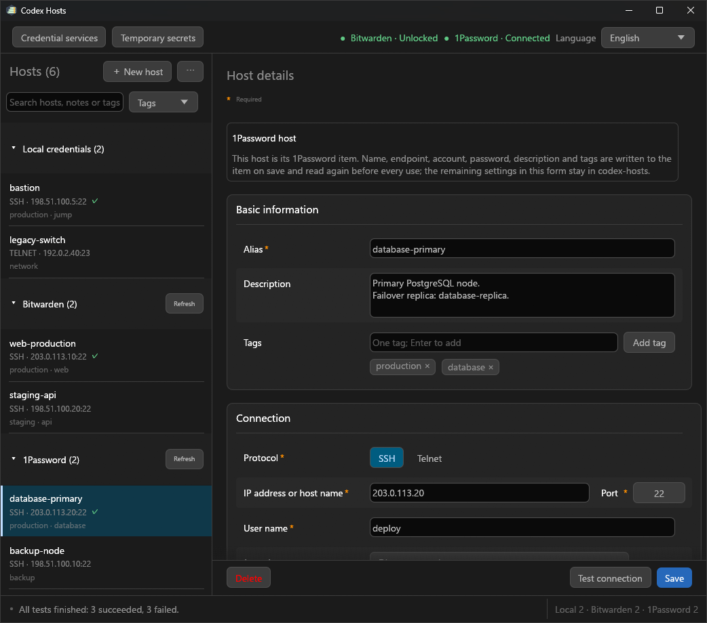

<h1 align="center">codex-hosts</h1>

<p align="center">保存主机，掌握凭据，让 Codex 完成远程任务。</p>

<p align="center">
  <a href="https://github.com/Torinomii/codex-hosts/tree/v0.4.0"></a>
  <a href="https://github.com/Torinomii/codex-hosts/actions/workflows/release.yml"></a>
  <a href="../../LICENSE"></a>
  
  <a href="https://linux.do/"></a>
</p>

<p align="center">
  <a href="../../README.md">English</a> · <a href="README_zh-CN.md">简体中文</a> · <a href="README_zh-TW.md">繁體中文</a> · <a href="README_ja.md">日本語</a>
</p>

<p align="center">
  <a href="https://github.com/Torinomii/codex-hosts/releases">下载</a> · <a href="#安装">安装</a> · <a href="#快速上手">快速上手</a> · <a href="#版本记录">版本记录</a> · <a href="#技术参考">技术参考</a>
</p>

供 Codex 使用的 Windows SSH / Telnet 主机管理工具与 MCP 服务器。将主机保存在本地，或 Bitwarden、1Password 保管库中，就能让 Codex 连接、执行命令或批量操作多台机器。密码、私钥口令和 FIDO PIN 在本机输入，不进入对话或工具参数。

<p align="center">
  
</p>

## 功能概览

| 能力 | 可以做什么 |
| --- | --- |
| 主机管理 | 保存 SSH / Telnet 配置、备注和标签，支持搜索、筛选、导入和导出。 |
| 凭据服务 | 主机登录凭据可保存在 Windows 凭据管理器、Bitwarden 文件夹或 1Password 保险库；每个服务都有自己的列表分区、设置向导和工具栏状态。 |
| 多种认证 | 支持密码、OpenSSH 私钥、FIDO / YubiKey、Windows OpenSSH Agent 和 Pageant。 |
| 远程命令 | 执行命令、通过 stdin 发送文本，或用 sudo / su 明确指定执行用户。 |
| 并发与批量 | 在同一 SSH 连接上运行多条命令，或对明确指定的主机列表进行探测和执行。 |
| 连接控制 | 验证主机指纹和跳板链，按主机选择逐次认证、会话保持或空闲后断开。 |
| 调用审批 | 查看 SSH 完整命令和等待批次，为临时秘密的每个字段独立设置审批。 |
| 临时秘密 | 将 API Key、Token 保存在进程内存中，注入指定本地程序的环境变量。 |

## 0.4.0 更新亮点

- **Bitwarden 主机：** Bitwarden 某个文件夹中的登录项目即主机：项目名称 = 别名，`ssh://` 或 `telnet://` URI = 连接地址，用户名和密码 = 登录凭据。每次使用前都通过官方 `bw` CLI 重新读取，保管库中的修改在下一次调用时生效。
- **1Password 主机：** 1Password 某个保险库中的登录项目即主机，通过官方 `op` CLI 与 1Password 桌面 App 读取，由 App 请求你允许 codex-hosts。
- **设置向导：** Bitwarden 依次设置 CLI、服务器、含新设备验证的登录和文件夹；1Password 自动搜索 `op.exe`，在授权窗口出现前先行说明，并选择或新建保险库。
- **所有凭据服务共用一套主机管理：** 本地、Bitwarden 与 1Password 主机共用列表、编辑器和对话框；保存或删除保管库主机会写入对应项目（1Password 项目改为归档）。工具栏显示各服务状态，状态栏按服务统计主机数量。
- **每次调用只弹一个对话框：** 需要审批的调用遇到 Bitwarden 保管库已锁定时，直接在审批对话框中输入主密码。sudo 和 su 复用从项目读取的登录密码。
- **编辑器：** 放弃未保存的修改前先确认，并提供“还原修改”和“删除”。密码框可切换显示，且不保留撤销记录。

[查看版本差异](https://github.com/Torinomii/codex-hosts/compare/v0.3.3...v0.4.0)

## 安装

使用预编译包可以最快完成安装，也可以从固定路径的源码目录构建。两种方式都通过符号链接安装完整 Skill。

| 方式 | 所需环境 | 入口 |
| --- | --- | --- |
| GitHub Release | 64 位 Windows 10+、PowerShell 7.2+ | `install.cmd` 或下方命令 |
| 源码构建 | 上述环境，加 Rust 1.92+、MSVC 和 Windows SDK | `scripts/install.cmd` 或 `scripts/install-local-skill.ps1` |

### 1. 安装程序与 Skill

从 [Releases 页面](https://github.com/Torinomii/codex-hosts/releases)下载 `codex-hosts-windows-x86_64.zip`，解压到固定目录，然后在该目录运行：

```powershell
pwsh -NoProfile -File .\install-local-skill.ps1 -ReleasePackage
```

ZIP 默认包含程序、完整 Skill、`install-local-skill.ps1` 和 `install.cmd`。双击 `install.cmd` 可进入相同的分步流程，缺少 PowerShell 7.2+ 时会给出安装提示。Release 安装不需要 Rust 或 Visual Studio；环境检查后确认安装路径，发现旧副本、过期链接或错误的程序路径时，再确认更新覆盖。

0.3.1 之后的 Release 还附带 `codex-hosts-windows-x86_64.zip.sha256`，解压前请与 `(Get-FileHash .\codex-hosts-windows-x86_64.zip).Hash` 核对。

**请保留解压目录或源码目录。** 已安装的 Skill 会链接到它，当前 Windows 用户须有创建符号链接的权限。安装时保留完整包，包括参考文档和可执行文件。

### 2. 注册 MCP 服务器

在 `%USERPROFILE%\.codex\config.toml`（或工作区的 `.codex\config.toml`）中添加一次，将 `<user>` 替换为 Windows 账号名：

```toml
[mcp_servers.codex-hosts]
command = "C:\\Users\\<user>\\.codex\\skills\\codex-hosts\\bin\\codex-hosts.exe"
args = ["--mcp"]
startup_timeout_sec = 20
tool_timeout_sec = 86400
```

<details>
<summary><strong>从源码构建，或链接已有源码目录</strong></summary>

### 从源代码构建

```powershell
pwsh -NoProfile -File .\scripts\install-local-skill.ps1
```

推荐运行 `pwsh -NoProfile -File .\scripts\install-local-skill.ps1`（也可双击 `scripts\install.cmd`）。脚本自动检查 PowerShell 7.2+、Rust 1.92+、x86_64 MSVC 工具链及 Windows SDK，然后依次询问是否开始编译、是否安装软链接。缺少工具时提供指引，不会自动安装。引导式编译输出为 `target\x86_64-pc-windows-msvc\release\codex-hosts.exe`。

也可使用 Rust 1.92+ 和 MSVC 工具链手动编译：

```powershell
git clone https://github.com/Torinomii/codex-hosts.git
cd codex-hosts
cargo build --locked --release
```

生成的可执行文件位于：

```text
target\release\codex-hosts.exe
```

手动构建后，运行下面的链接安装命令并加上 `-SkipBuild`；脚本优先使用已有的引导式编译产物，否则使用 `target\release\codex-hosts.exe`。

### 链接本地源码目录

如果在固定路径的本地源码目录中开发，可以安装软链接，之后每次构建无需再复制：

```powershell
pwsh -NoProfile -File .\scripts\install-local-skill.ps1 -SkipBuild
```

脚本把已安装的 `codex-hosts` 目录整体链接到 `skill\codex-hosts`，其中的 `bin\codex-hosts.exe` 再链接到所选编译产物；重新构建同一目标后无需复制。发现复制式文件/目录、错误或悬空链接时，会展示旧、新路径并询问是否替换。原内容保留在相邻的 `.codex-hosts.backup-*` 路径中；安装失败时尝试恢复两处链接。正确链接保持不变。请保留源码或解压目录；移动后重新运行脚本并确认新目标。

Windows 必须允许创建符号链接。检查失败时，请自行开启「开发者模式」或以管理员身份运行 PowerShell 后重试。脚本不会修改系统设置、关闭应用或退回复制安装；若运行中的程序被锁定，请在方便时自行关闭后再编译。

</details>

<details>
<summary><strong>安装参数与 Skill 目录结构</strong></summary>

安装后的 Skill 结构：

```text
%USERPROFILE%\.codex\skills\codex-hosts\
├── SKILL.md
├── bin\
│   └── codex-hosts.exe
├── agents\
└── references\
```

可用 `-CodexHome <目录>` 覆盖 `CODEX_HOME` / `%USERPROFILE%\.codex`（例如 `-CodexHome "$env:USERPROFILE\.agents"` 安装到 `.agents\skills`）。自动化可用 `-NonInteractive -Build -Install`，已有编译产物则用 `-NonInteractive -SkipBuild -Install`；替换旧内容还须明确添加 `-ReplaceExisting`。`-SkipInstall` 表示只编译不安装，未明确同意的提示默认选择否。

从本地制作的分发 ZIP 安装时也使用同一脚本，加上 `-ReleasePackage`，并保留解压目录。

也可以直接让 Codex 安装：

```text
将 https://github.com/Torinomii/codex-hosts.git 克隆到固定目录，运行 scripts/install-local-skill.ps1 检查编译环境；编译、安装软链接和替换旧路径前都先让我确认。
确认已安装的整个 codex-hosts Skill 目录是一个符号链接、可执行文件解析到发布版构建，按 SKILL.md 在 config.toml 中注册 codex-hosts MCP 服务器，并保留源码目录。
```

</details>

## 快速上手

### 1. 添加主机

打开 `codex-hosts.exe`，选择“新建主机”，填写别名、地址、端口、用户名、协议和认证方式。按需添加备注与标签，然后保存。设置密码管理器后，同一菜单也能新建 Bitwarden 或 1Password 主机。

### 2. 选择认证方式

| 认证方式 | 说明 |
| --- | --- |
| Password | 使用密码登录，密码保存在 Windows 凭据管理器中 |
| OpenSSH Key | 使用普通 OpenSSH 私钥文件 |
| FIDO / 安全密钥 | 使用 OpenSSH FIDO Handle，通过硬件设备完成签名 |
| SSH Agent | 使用已经加载到 Windows OpenSSH Agent 或 Pageant 中的身份 |

这些认证方式中的敏感值不会通过 Codex 对话传递。

### 3. 可选：把主机放在 Bitwarden 或 1Password

在工具栏打开“凭据服务”，为某个服务选择“开始设置…”。向导检查官方 CLI 并连接账户后，主机列表中会出现该服务的分区，工具栏也会显示其状态。

| 服务 | 需要 | 哪些项目是主机 |
| --- | --- | --- |
| Bitwarden | 官方 Bitwarden CLI（`bw.exe`），以及 bitwarden.com、bitwarden.eu 或自托管服务器上的账户 | 一个文件夹中的登录项目 |
| 1Password | 正在运行、并开启“设置 › 开发者 › 与 1Password CLI 集成”的 1Password 桌面 App，以及官方 1Password CLI（`op.exe`） | 一个保险库中的登录项目；建议使用专用保险库 |

### 4. 让 Codex 使用主机

告诉 Codex 已保存的主机别名和任务即可，例如：

```text
连接 example，执行 hostname。
检查 web-1 和 web-2 的磁盘使用情况。
连接 server1，检查 hostname、uptime 和磁盘空间。
```

Skill 会查找主机、验证指纹、完成认证并返回结构化执行结果，日常使用不需要手动调用 MCP 工具。

## 安全边界

| 控制项 | 行为 |
| --- | --- |
| 登录凭据 | 密码和私钥口令保存在 Windows 凭据管理器，保管库主机则保存在其 Bitwarden / 1Password 项目中；FIDO PIN 不保存。 |
| Bitwarden / 1Password | 每次使用前重新读取项目。主密码和新设备验证码只在本程序中输入；1Password 只在其自身 App 中解锁。 |
| 主机身份 | 未知或变化的 SSH 指纹需要确认，跳板链中的每一跳也会验证。 |
| 会话保持 | 复用会话会跳过后续认证和硬件密钥触碰；调用审批是独立设置。 |
| sudo / su | 每次调用明确选择用户；保存密码供给分别授权，仅处理最外层认证。 |
| 临时秘密 | 只保存在内存中，每个字段默认要求审批；退出托盘程序后清空。 |

> **Telnet 不提供加密。** 凭据、命令和结果可能以明文传输。仅在接受此风险的可信网络中使用，互联网连接优先选择 SSH。

<details>
<summary><strong>凭据存储、密码管理器、主机信任、认证保持与临时秘密的详细说明</strong></summary>

### 登录凭据

密码和私钥文件口令会持久化保存在 Windows 凭据管理器中。

这些敏感值不会：

- 写入主机配置
- 放入 MCP 工具参数或结果
- 作为命令行参数传递
- 返回给 Codex

FIDO PIN 只用于当前操作，不会保存。

### Bitwarden 与 1Password 主机

主机可以存放在密码管理器中，而不是凭据管理器。登录项目保存别名、连接地址、用户名、密码、备注和标签；其余设置（认证保持、调用审批、跳板主机和高级选项）留在 `codex-hosts`。每次使用前都通过厂商的官方 CLI 重新读取项目，保管库中的修改在下一次调用时生效；在窗口中保存主机会写回项目。

- **Bitwarden：** `codex-hosts` 在自己的提示框中请求主密码；调用需要审批时，则在审批对话框中请求。“重新验证”决定会话密钥保留多久：每次调取、闲置一段时间后、直到 `codex-hosts` 关闭，或直到你按“锁定”。保留的密钥存于 Windows 凭据管理器，结束时也会执行 `bw lock`。
- **1Password：** `codex-hosts` 不会接触你的账户密码。1Password App 请求你允许 codex-hosts，并以 Windows Hello 或账户密码确认；闲置 10 分钟后、且至少每 12 小时会再次请求。删除主机会归档对应项目。

### SSH Host Key

SSH 主机指纹必须由用户明确确认。

首次连接未知主机时，`codex-hosts` 会显示实际检测到的主机指纹。

只有用户确认后才会保存。

如果服务器 Host Key 后续发生变化，程序不会自动替换已经保存的指纹，必须再次由用户明确确认。

### 认证保持

旧版本的主机和导入的主机在 Codex 的每次调用都重新认证：硬件密钥每个动作触碰一次，Codex 在两次调用之间不持有任何打开的会话。新建主机预选"Codex 会话期间保持"；编辑器会在首次保存时以及之后每次更改（无论改向哪一档）时要求确认。每台主机都可以在"认证"卡片中选择任意一项：

| 选项 | 行为 |
| --- | --- |
| 每次操作重新认证 | 调用结束即断开连接。旧版本主机与导入的主机从这一项开始。 |
| Codex 会话期间保持 | 新建主机预选。已认证的会话保持打开并发送 keepalive，直到 Codex 退出、链路断开或调用 `disconnect`。 |
| 空闲后断开 | 会话保持到空闲达到设定的分钟数为止。 |

保持会话期间，Codex 对该主机的后续命令不再重新认证或触碰安全密钥，也就取消了"每个动作一次确认"的保护。编辑器会显示这条警告，保持会话的主机在列表中带有标记，并且 Skill 禁止 Codex 建议修改这一设置。Telnet 主机始终每次重新认证。凭据、PIN 和主机密钥检查均不受影响，被复用的只是活动会话。

### 临时秘密

`codex-hosts` 还可以临时保存 API Key、Token 等与主机登录无关的敏感参数。

这类值只保存在当前 `codex-hosts` 进程内存中，不保存到 Windows 凭据管理器，也不会返回给 Codex。

每个字段的“调用审批”使用与主界面一致的复选框，默认开启。字段名、遮罩秘密值和审批控件按统一列对齐，窄窗口自动上下排列。程序使用的字段只要有一个开启审批，就会在临时秘密窗口内部显示蓝色授权弹窗，顶部按钮只决定本次执行。点击命令可打开完整详情，长文本支持分页和复制全文；详情里的返回或 Esc 不作审批决定。所有引用字段都关闭审批时，可直接注入指定程序的环境变量并执行。

顶部“全部删除”经确认后移除所有字段、已保存值和未保存草稿，同时取消等待中的操作；不会停止已运行的程序。单项“清空”和 `temporary_secrets_clear` 仍只清空值、保留字段。

退出 `codex-hosts` 托盘程序、注销或重启系统后，这些临时值会失效；Codex 的启动或退出不影响它们。

完整说明见 [`temporary-secrets.md`](../../skill/codex-hosts/references/temporary-secrets.md)。

</details>

## 版本记录

展开版本可查看完整变更。当前 0.4.0 的亮点见上方。

<details>
<summary><strong>0.4.0 · Bitwarden 与 1Password 主机</strong></summary>

- **Bitwarden 主机：** 一个文件夹中的登录项目即主机（名称 = 别名，`ssh://` 或 `telnet://` URI = 连接地址，用户名和密码 = 登录凭据，备注和标签存于 `codex-hosts:` 自定义字段）。每次使用前，官方 `bw` CLI 会在不超过所选时限的同步之后重新读取项目。在文件夹中新建的主机，列表刷新前也能按别名找到。
- **Bitwarden 设置与锁定：** 向导依次设置 CLI、服务器（bitwarden.com、bitwarden.eu 或自托管）、含新设备验证的登录和文件夹。“重新验证”决定保管库保持解锁多久：每次调取、闲置一段时间后、直到窗口关闭，或直到手动锁定。保留的密钥存于 Windows 凭据管理器，结束时也会执行 `bw lock`。
- **1Password 主机：** 一个保险库中的登录项目即主机，通过官方 `op` CLI 与 1Password 桌面 App 读取。向导自动搜索 `op.exe`（winget、Scoop、Chocolatey、Program Files、PATH），在 App 授权窗口出现前和等待时给出说明，并选择或新建保险库。编辑前先比对项目版本，若期间在 1Password 中被改动，会提示而不覆盖。
- **共用主机管理：** 本地与保管库主机使用相同的列表分区、编辑器、删除对话框和按服务统计的主机数量。“凭据服务”列出所有服务，已设置的服务在工具栏显示状态。不能作为主机的项目会在服务页面列出，并说明缺少什么。
- **调用：** 每次调用只弹一个对话框。需要审批且 Bitwarden 保管库已锁定时，在审批对话框中输入主密码。sudo 和 su 复用该次调用从项目读取的登录密码。新增的 `BITWARDEN_*` 与 `ONEPASSWORD_*` 错误码告诉 Codex 用户需要做什么。
- **编辑器：** 放弃未保存的修改前先确认，并提供“还原修改”和“删除”。密码框可切换显示，且不保留撤销记录。破坏性操作的确认按钮改为红色实心。
- **Skill 与 MCP：** `list_hosts` 返回 `credential_source`；说明与 Skill 描述了保管库主机、授权提示及其错误码。

[查看版本差异](https://github.com/Torinomii/codex-hosts/compare/v0.3.3...v0.4.0)

</details>

<details>
<summary><strong>0.3.3 · sudo / su、调用审批与引导安装</strong></summary>

- **Sudo / su：** `exec_sudo` 和 `exec_su` 以明确选择的用户执行绝对路径程序及原样参数。「高级」中的独立开关只授权使用保存密码，关闭时仍可免密执行。密码保持与账号绑定，不进入工具参数。
- **编辑器：** sudo/su 使用与其他高级选项一致的表单行和复选框，可选账号密码默认折叠；不重复登录输入，不设置默认执行目标，也不再提供专用的 sudo/su 保存测试按钮。修改账号不会把已有密码转移给另一用户。
- **调用审批：** 按主机设置的可选开关在每次 SSH 调用前要求确认，涵盖探测、用户切换和批量操作。蓝色弹窗提供完整命令、输入、详情、到期提示和决定反馈；批量按钮只作用于当前展示的调用批次，保持连接不会复用审批。
- **临时秘密：** 每个字段都有默认开启的审批开关。引用字段只要有一个要求审批，本次执行就需确认；全部关闭时直接执行，或等待当前本地子进程结束。保存或清除字段会撤销等待中的执行。
- **Skill：** 更新 sudo/su 和授权弹窗指引，说明免密路径、显式执行用户和失败处理。普通命令及脚本内部的 sudo/su 不会获得透明自动供密。
- **凭据安全：** 修改登录账号时轮换密码记录，进行中的 sudo/su 调用无法读取另一账号的新密码。旧版密码迁移成功后清理旧槽，删除密码时也会清理迁移来源。
- **安装：** 源码和 Release 统一使用软链接。分步脚本检查环境、询问是否编译和安装；发现旧副本或错误链接时，提示更新路径并保留备份。

[查看版本差异](https://github.com/Torinomii/codex-hosts/compare/v0.3.2...v0.3.3)

</details>

<details>
<summary><strong>0.3.2 · 完整 Skill 目录链接</strong></summary>

- **整体链接：** 已安装的 `codex-hosts` Skill 改为链接整个源码 Skill 目录，使 `SKILL.md`、`agents` 和 `references` 保持在一起；可执行文件在源码 Skill 内单独链接。
- **Windows 构建准备：** 加入 `winresource` 构建依赖，包版本更新为 0.3.2。

[查看版本差异](https://github.com/Torinomii/codex-hosts/compare/v0.3.1...v0.3.2)

</details>

<details>
<summary><strong>0.3.1 · MCP 工具、认证保持与连接可靠性</strong></summary>

- **MCP 服务器：** `codex-hosts.exe --mcp` 通过 stdio 为 Codex 提供服务。主机、探测、命令、批量、主机编辑器和临时秘密都是带风险注解的 MCP 工具，不再经过 shell、PowerShell 包装或临时请求文件。原有的文件式 Tool 模式原样保留，尚未更新的 Skill 仍可正常工作。
- **认证保持：** 每台主机现在都要选择 Codex 是在 Codex 会话期间保持会话（新建主机预选；首次保存和每次更改都会要求确认）、每次操作重新认证（原有行为，旧版本主机与导入的主机保持此项），还是空闲指定分钟后断开。保持会话的主机在列表中带有标记，编辑器中显示警告。
- **编辑器：** 必填项标有 `*`，保存时留空会被高亮；新增"高级"卡片，提供按主机的并发通道数、默认超时、Keepalive 间隔、供 Codex 参考的远端环境提示、对 Codex 隐藏主机以及 Telnet 提示符覆盖。
- 取消 Codex 调用会立即停止等待并关闭通道；长时间作业的做法改为依赖远端主机自己的 `tmux` / `screen`，而不是长时间等待。
- `codex-hosts.exe --version` 输出版本号，参数错误会写到 stderr。
- **连接可靠性：** 改善真实 Telnet 登录提示和回显处理、SSH 跳板连接清理、主机配置变更处理，以及保持会话的空闲计时。
- **诊断反馈：** MCP 结果附带版本号，单个凭据读取失败不会导致整个主机列表不可用；MCP 启动时检查主机配置文件的所有者。
- **发布交付：** Actions 校验并打包程序、完整 Skill、链接安装入口及 SHA-256 校验文件。

[查看版本差异](https://github.com/Torinomii/codex-hosts/compare/v0.3.0...v0.3.1)

</details>

<details>
<summary><strong>0.3.0 · 主机界面重设计、备注与标签</strong></summary>

- **主机备注与标签：** 可按备注或标签搜索、筛选列表，Codex 也能通过 `--description`、`--tag` 预填；`list_hosts` 会返回这两个字段并支持 `tags` 过滤，`exec` 新增 `stdin` 用于传入命令输入。
- **界面重新设计：** 主机列表可拖动调整宽度、头部更紧凑；主机详情按"基本信息 / 连接 / 身份验证 / SSH 主机密钥"分区显示；"测试连接"和"保存"固定在底部操作栏。
- **状态栏与通知：** 所有操作结果显示在底部状态栏，警告和错误还会在右上角弹出可关闭的提示。
- **批量管理：** 工具栏下方出现选择栏，显示已选数量以及全选、导出、删除；列表行带复选框，按 `Esc` 退出。
- 导入和导出改为对话框，需要关闭后才能继续操作；所有确认对话框统一样式，破坏性操作会高亮显示。
- **布局随窗口大小自适应：** 窗口宽度 1040 px 起表单为两列，最小窗口下标签改为上下排列；同时支持 Windows 浅色与深色主题。

[查看版本差异](https://github.com/Torinomii/codex-hosts/compare/v0.2.3...v0.3.0)

</details>

## 技术参考

<details>
<summary><strong>MCP 工具</strong></summary>

Codex 通过 stdio 与 `codex-hosts.exe --mcp` 通信。每个工具都同时以 `structuredContent` 和文本返回同一份 JSON，并带有 MCP 注解，便于策略层区分只读工具和会执行代码的工具。

| 工具 | 用途 |
| --- | --- |
| `list_hosts` | 已保存主机的非敏感信息、`credential_source`、信任状态、`auth_persistence`、`require_call_approval`、sudo/su 供密权限、`max_channels`、`remote_env` |
| `agent_identities`、`fido_identities` | 已加载 Agent 身份与 FIDO Handle 的公开信息 |
| `probe`、`batch_probe` | 认证并运行 `hostname`；暴露未知或变更的主机密钥 |
| `exec`、`exec_stdin`、`exec_many`、`batch_exec` | 执行命令；`exec_stdin` 单独成工具，因为 stdin 里的程序正文对审查不透明 |
| `exec_sudo` | 在 SSH 主机上以明确指定的 `user` 执行绝对路径程序及 argv；供密获准时，普通 sudo 复用当前用户的 SSH 登录密码 |
| `exec_su` | 通过 su 以明确指定的目标 `user` 执行绝对路径程序；远端策略允许时无需密码 |
| `disconnect` | 断开为已选择保持会话的主机保留的连接 |
| `open_host_editor` | 打开预填了非敏感信息的编辑器窗口，或确认上报的主机密钥 |
| `temporary_secrets_open`、`_status`、`_run`、`_clear` | 由托盘程序持有的仅内存秘密 |

参数中永远不包含密码、口令或 PIN；编辑器在遮罩输入框中收集它们。超时（`connect_timeout_ms`、`command_timeout_ms`、`batch_timeout_ms`）按调用传入，省略时默认连接 120 秒、单条命令 10 分钟，或取主机"高级"卡片中的默认值。

SSH 主机的「高级」中有「每次 Codex 调用前审批」，默认关闭。目标或跳板主机开启后，连接前会通过蓝色弹窗审批本次调用涉及的全部主机和命令。授权覆盖这次 Codex 调用从拉起到结束的生命周期；下次调用需要重新审批，保持连接不会延长授权。顶部“全部允许 / 全部拒绝”只处理当前展示的这批等待调用，后来到达的请求须点击“查看下一批”。点击命令可打开完整详情，区分实际执行主机和跳板，并展示完整命令、标准输入及 sudo 用户；详情顶部按钮决定整次调用。长文本可分页查看和复制全文，详情中的返回或 Esc 不作决定。界面显示数量、到期倒计时及审批反馈；允许按钮为红色，拒绝按钮为白色。

SSH 调用审批、临时秘密审批和 sudo/su 供密权限相互独立。等待审批的请求在五分钟后到期，审批通过不代表命令执行成功。弹窗行为和失败处理见 [approvals.md](../../skill/codex-hosts/references/approvals.md)。

「高级」中的「允许 sudo 使用保存的密码」仅授权使用保存的密码。关闭时仍可使用免密或已有认证缓存；实际要求密码时返回 `SUDO_AUTO_AUTH_DISABLED`，不为该认证请求读取或发送密码。执行用户由 Codex 每次选择：`exec_sudo` 必填 `alias`、绝对路径 `program`、`user`，可选原样 `args` 和超时参数；需要 root 时显式传入 `"user":"root"`，不再保存默认目标。sudo/su 开关采用与其他选项一致的表单行和复选框。密码登录直接复用 SSH 登录密码，不重复显示登录用户名和密码框；密钥、Agent 登录或已有独立密码的账号，可在开启供密后展开「独立系统密码（可选）」。额外账号在「其他账号密码（可选）」折叠区管理。不使用其他用户的登录密码、密钥口令或 Agent 凭据；`rootpw`、`targetpw`、`runaspw` 按实际认证提示选择密码。留空保留已有密码；移除独立密码后仍可复用符合条件的登录密码。改名删除旧密码，可输入替换密码或留空。不再提供专用 sudo/su 保存测试按钮，普通连接测试保持不变。不接受原始命令、密码或业务 stdin，不自动重试。shell 启动器及 TTY/PAM 限制见 [sudo.md](../../skill/codex-hosts/references/sudo.md)。

「高级」中的「允许 su 使用保存的密码」独立授权 su 使用保存的密码；关闭时仍可免密执行，实际要求密码时返回 `SU_AUTO_AUTH_DISABLED`。`exec_su` 同样要求每次填写 `user`、绝对路径 `program`，可选原样 `args` 和超时参数。目标用户的可选密码在「其他账号密码」折叠区每用户一行管理；su 供密授权允许时可复用同一账号密码，无需重复输入登录密码。远端允许的 root 到普通用户等免密路径无需记录，完全不读取或发送密码。远端须提供 util-linux `/usr/bin/su`、`/usr/bin/env`、`/bin/sh` 及标准 Linux-PAM 提示；无 PTY 或业务 stdin。旧 JSON 默认目标会被忽略，已存密码槽保留；旧调用省略 `user` 会失败且不执行。详见 [su.md](../../skill/codex-hosts/references/su.md)。

这两个工具只处理外层 sudo/su 认证。普通 `exec` / `exec_stdin` 和已经启动的脚本内部的 sudo/su 不会自动供密；内部失败不会触发整段脚本提权或自动重放。

`open_host_editor` 的认证参数使用稳定名称：`password`；`private-key` / `private_key` 表示普通私钥文件或 FIDO Handle（也接受 `fido-handle`）；`ssh-agent` / `ssh_agent` 表示 Windows OpenSSH Agent 或 Pageant。

执行远程命令时请检查 `output_truncated`，判断输出是否因大小限制被截断。

完整的 Codex 行为、工作流和安全规则见 [`SKILL.md`](../../skill/codex-hosts/SKILL.md)。

</details>

<details>
<summary><strong>命令并发与多主机示例</strong></summary>

### SSH 单主机多命令

`exec_many` 可以复用同一条 SSH 连接，同时执行多条独立短命令：

```json
{
  "alias": "example",
  "commands": [
    "hostname",
    "uptime",
    "df -h"
  ],
  "max_concurrency": 8
}
```

它只进行一次 SSH 认证，然后通过同一条连接创建多个 Channel。

对于 FIDO / 安全密钥尤其有用，因为一组命令通常可以共用一次身份认证。

`exec_many` 仅用于 SSH 主机。

### 多主机批量执行

可以显式指定多个主机：

```json
{
  "aliases": [
    "web-1",
    "web-2",
    "web-3"
  ],
  "command": "uptime",
  "max_concurrency": 8,
  "batch_timeout_ms": 30000
}
```

也可以批量测试连接：

```json
{
  "aliases": [
    "web-1",
    "web-2"
  ],
  "max_concurrency": 8,
  "batch_timeout_ms": 30000
}
```

批量模式要求显式指定主机列表。

空列表不会被解释为“全部主机”。

</details>

<details>
<summary><strong>备注、标签、CSV 与 stdin</strong></summary>

主机支持多行 `description` 备注和多个 `tags` 标签。编辑器可以添加、移除标签；标签会去除首尾空格、空项及不区分大小写的重复项，并保留首次输入的写法。仅修改备注或标签不会清除连接验证和主机密钥信任。搜索覆盖别名、地址、用户名、备注和标签；多个标签筛选条件必须全部匹配。批量全选仅选择可见主机，切换筛选会移除隐藏主机的选择。

`list_hosts` 返回这两个字段，并接受可选的 `tags` 数组。省略或传入空数组时返回全部主机；不存在的标签返回空列表。`open_host_editor` 可预填 `description` 和 `tags`。省略字段保留原值；空备注或单个空标签可清空对应字段。CSV 模板及导入导出增加可选的 `description`、`tags` 列；标签单元格采用 `["prod","web"]` 这样的 JSON 数组，按 CSV 规则引用。旧配置和旧 CSV 继续兼容。

```json
{"tags":["prod","web"]}
{"alias":"example","command":"python3 -","stdin":"print('hello')\n","command_timeout_ms":10000}
```

`exec_stdin` 向单台 SSH 主机的命令发送精确的 UTF-8 文本，上限 1 MiB，不追加换行，结束后发送 EOF；`""` 立即发送 EOF。输入发送和输出读取并发进行，并沿用原有超时及输出限制。远端程序可以在读完输入前退出，此时以远端退出状态为准。输入过大返回 `STDIN_TOO_LARGE`；Telnet 主机返回 `STDIN_UNSUPPORTED`。程序不会自动重放命令。

</details>

<details>
<summary><strong>超时、探测审批与长时间任务</strong></summary>

`tool_timeout_sec` 只是上限；每次调用都带有自己的超时，且必须低于该上限。若保留 Codex 的默认值（300 秒），超过它的命令仍会运行到自身超时（未指定时为 10 分钟），不保持会话的主机的后续调用要等它结束。

`probe` 和 `batch_probe` 标注为只读，只执行 `hostname`，但仍会连接和认证，硬件密钥可能要求触碰。主机的调用审批设置同样适用于探测。如需额外要求 Codex 确认，可使用：

```toml
[mcp_servers.codex-hosts.tools.probe]
approval_mode = "prompt"

[mcp_servers.codex-hosts.tools.batch_probe]
approval_mode = "prompt"
```

为了避免异常命令产生无限输出或占用过多内存，命令执行存在明确限制。

- 单条命令最多捕获 **1 MiB** 输出。
- 完整 `exec_many` 或批量 JSON 结果最大为 **8 MiB**。
- `exec_many` 和批量任务使用受限并发。
- 输出被截断时，可通过 `output_truncated` 判断。
- 远程命令不会因为网络错误自动重新执行。
- 取消 Codex 调用会关闭通道并返回 `CANCELLED`；已经开始的远程命令可能继续运行。
- 超过几分钟的工作应放进远端主机的 `tmux` / `screen`，见 [`long-running.md`](../../skill/codex-hosts/references/long-running.md)。

不自动重试是因为远程命令可能不是幂等操作，例如：

```text
reboot
rm
systemctl restart
数据库写入
部署操作
```

网络异常并不意味着同一命令可以安全执行第二次。

</details>

<details>
<summary><strong>FIDO / 安全密钥与 SSH Agent</strong></summary>

`codex-hosts` 可以使用现有的 OpenSSH ECDSA-SK 和 Ed25519-SK FIDO Handle。

例如：

```text
id_ecdsa_sk
id_ed25519_sk
```

使用应用内创建或恢复新的 FIDO SSH 凭据时，使用 ECDSA-SK。

FIDO 模式下：

- 硬件私钥不会离开安全设备。
- FIDO PIN 只用于当前操作，不会保存。
- 不要求启用 SSH Agent。
- Agent Forwarding 始终关闭。
- 根据安全密钥配置，认证过程中可能需要 PIN 或 Touch。

FIDO Handle 和 SSH Agent 是两种不同的认证方式。

FIDO Handle：

```text
codex-hosts
    │
    ▼
OpenSSH FIDO Handle
    │
    ▼
安全密钥
```

由 `codex-hosts` 直接通过系统组件完成硬件签名。

SSH Agent：

```text
codex-hosts
    │
    ▼
OpenSSH Agent / Pageant
    │
    ▼
已加载的身份
```

认证工作交给已经运行的 Agent。

`codex-hosts` 不会为了使用 Agent 模式而自动启动、启用或持久化 Agent 服务。

</details>

<details>
<summary><strong>SSH 跳板链</strong></summary>

SSH 主机可以使用其他已经保存并验证的 SSH 主机作为 Jump Host。

例如：

```text
Codex
  │
  ▼
jump-1
  │
  ▼
jump-2
  │
  ▼
target
```

安全规则：

- Jump Host 必须是已经验证的 SSH 主机。
- 每个 Hop 都需要验证 Host Key。
- 不允许 Jump Host 链循环。
- 一条 SSH 链最多包含 8 台主机。
- Agent Forwarding 始终关闭。

</details>

<details>
<summary><strong>项目结构</strong></summary>

```text
codex-hosts
├── src\
├── skill\
│   └── codex-hosts\
│       ├── SKILL.md
│       ├── agents\
│       └── references\
├── languages\
├── docs\
│   └── readme\
│       ├── README_zh-CN.md
│       ├── README_zh-TW.md
│       └── README_ja.md
├── Cargo.toml
├── Cargo.lock
├── Main.png
└── README.md
```

</details>

## License

本项目使用 [Apache License 2.0](../../LICENSE)。
