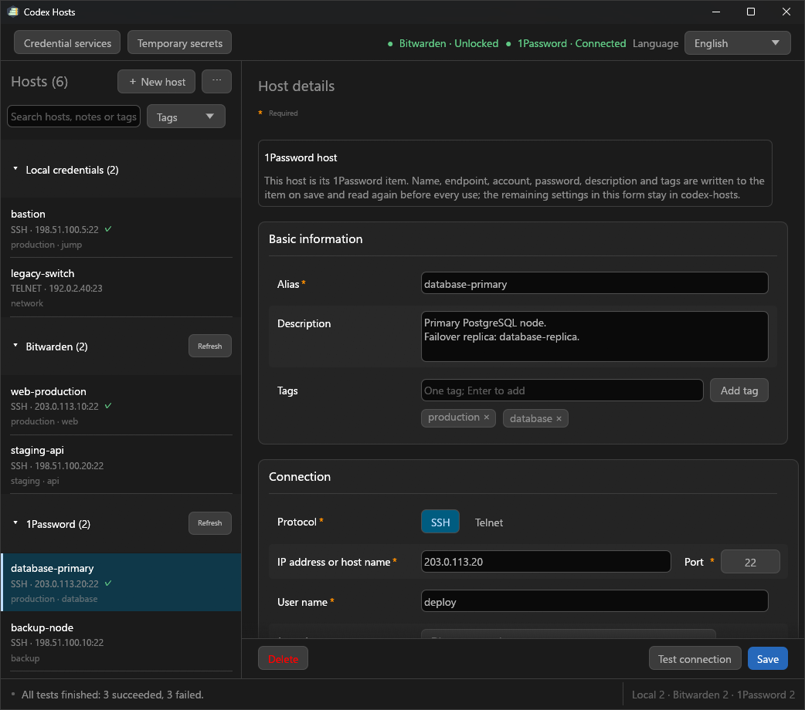

<h1 align="center">codex-hosts</h1>

<p align="center">儲存主機，掌握憑據，讓 Codex 完成遠端任務。</p>

<p align="center">
  <a href="https://github.com/Torinomii/codex-hosts/tree/v0.4.0"></a>
  <a href="https://github.com/Torinomii/codex-hosts/actions/workflows/release.yml"></a>
  <a href="../../LICENSE"></a>
  
  <a href="https://linux.do/"></a>
</p>

<p align="center">
  <a href="../../README.md">English</a> · <a href="README_zh-CN.md">简体中文</a> · <a href="README_zh-TW.md">繁體中文</a> · <a href="README_ja.md">日本語</a>
</p>

<p align="center">
  <a href="https://github.com/Torinomii/codex-hosts/releases">下載</a> · <a href="#安裝">安裝</a> · <a href="#快速上手">快速上手</a> · <a href="#版本記錄">版本記錄</a> · <a href="#技術參考">技術參考</a>
</p>

供 Codex 使用的 Windows SSH / Telnet 主機管理工具與 MCP 伺服器。將主機儲存在本機、Bitwarden 或 1Password 中，就能讓 Codex 連線、執行命令或批次操作多台機器。密碼、私鑰密碼片語和 FIDO PIN 在本機輸入，不進入對話或工具參數。

<p align="center">
  
</p>

## 功能概覽

| 能力 | 可以做什麼 |
| --- | --- |
| 主機管理 | 儲存帶備註與標籤的 SSH / Telnet 主機，支援搜尋、篩選、匯入及匯出。 |
| 憑據存放 | 登入憑據可儲存在 Windows 認證管理員、Bitwarden 資料夾或 1Password 保管庫。 |
| 多種驗證 | 密碼、OpenSSH 私鑰、FIDO / YubiKey、Windows OpenSSH Agent 與 Pageant。 |
| 遠端命令 | 執行命令、傳送 stdin，或用 sudo / su 以明確指定的使用者執行程式。 |
| 並行與批次 | 在同一條 SSH 連線上執行多條命令，或對明確指定的主機清單執行。 |
| 連線控制 | 驗證主機指紋與跳板鏈；依主機選擇逐次驗證、工作階段保持或閒置後斷開。 |
| 呼叫審批 | 可在每次 SSH 呼叫連線前進行審閱。 |
| 臨時秘密 | 將 API Key、Token 只保存在記憶體中，並注入本機程式的環境變數。 |

## 0.4.0 更新亮點

- **Bitwarden 主機：** 所選資料夾中的每個登入項目都是一台主機（名稱 = 別名，`ssh://` 或 `telnet://` URI = 連線位址，使用者名稱與密碼 = 登入憑據）。每次使用前都透過官方 `bw` CLI 重新讀取，保管庫中的修改在下一次呼叫時生效。
- **1Password 主機：** 所選 1Password 保管庫中的登入項目同樣作為主機，透過官方 `op` CLI 與 1Password 桌面 App 讀取。解鎖始終在 1Password 中完成。
- **在視窗中管理：** 保管庫主機與本地主機使用同一個編輯器新增、編輯與刪除。跳板主機、呼叫審批與進階設定儲存在 `codex-hosts` 中。

[查看版本差異](https://github.com/Torinomii/codex-hosts/compare/v0.3.3...v0.4.0)

## 安裝

最快的方式是讓 Codex 安裝。把以下內容貼給 Codex：

```text
從 https://github.com/Torinomii/codex-hosts/releases/latest 安裝 codex-hosts 的最新發行版：下載 codex-hosts-windows-x86_64.zip 與 codex-hosts-windows-x86_64.zip.sha256，檢查碼不一致就停止。
先問我要安裝到哪個目錄，並告訴我已安裝的 Skill 會連結到該目錄，因此之後不能移動它。把 ZIP 解壓縮到那裡並執行 install-local-skill.ps1 -ReleasePackage；取代舊安裝前先讓我確認。
確認已安裝的 codex-hosts Skill 目錄是指向該目錄的單一符號連結，然後依 SKILL.md 在 config.toml 中註冊 codex-hosts MCP 伺服器。
```

Codex 會下載並驗證最新 Release，安裝到你選擇的位置，並註冊 MCP 伺服器，全程無需編譯。如需手動安裝，請依表格後的兩個步驟操作。

| 方式 | 所需環境 | 入口 |
| --- | --- | --- |
| 讓 Codex 安裝（建議） | Codex + 「GitHub Release」的環境 | 上方提示詞 |
| GitHub Release | 64 位元 Windows 10+、PowerShell 7.2+ | `install.cmd` 或下方命令 |
| 原始碼建置 | 上述環境，加 Rust 1.92+、MSVC 與 Windows SDK | `scripts/install.cmd` 或 `scripts/install-local-skill.ps1` |

### 1. 安裝程式套件

從 [Releases 頁面](https://github.com/Torinomii/codex-hosts/releases)下載 `codex-hosts-windows-x86_64.zip`，用同處發布的 `.sha256` 核對（`(Get-FileHash .\codex-hosts-windows-x86_64.zip).Hash`），解壓縮到固定目錄後執行：

```powershell
pwsh -NoProfile -File .\install-local-skill.ps1 -ReleasePackage
```

按兩下 `install.cmd` 會啟動同一個引導式安裝程式。它會檢查環境，並在取代舊安裝前徵求確認。

**請勿移動解壓縮後的目錄。** 已安裝的 Skill 是指向它的符號連結，因此 Windows 必須允許目前使用者建立符號連結。

### 2. 註冊 MCP 伺服器

在 `%USERPROFILE%\.codex\config.toml`（或工作區的 `.codex\config.toml`）中加入以下內容，並把 `<user>` 換成你的 Windows 帳戶名稱：

```toml
[mcp_servers.codex-hosts]
command = "C:\\Users\\<user>\\.codex\\skills\\codex-hosts\\bin\\codex-hosts.exe"
args = ["--mcp"]
startup_timeout_sec = 20
tool_timeout_sec = 86400
```

<details>
<summary><strong>從原始碼建置</strong></summary>

```powershell
git clone https://github.com/Torinomii/codex-hosts.git
cd codex-hosts
pwsh -NoProfile -File .\scripts\install-local-skill.ps1
```

指令碼會檢查 PowerShell、Rust、MSVC 工具鏈與 Windows SDK，說明缺少的部分，並在編譯與建立連結前分別徵求確認。已安裝的 Skill 連結到 `skill\codex-hosts`，Skill 中的 `bin\codex-hosts.exe` 連結到建置產物，因此重新建置即可更新已安裝的程式。被取代的路徑保留為 `.codex-hosts.backup-*`。

手動建置時，先執行 `cargo build --locked --release`，再加 `-SkipBuild` 安裝。

無法建立符號連結時，請開啟開發人員模式或使用系統管理員 PowerShell；指令碼不會自行修改系統設定。

| 參數 | 作用 |
| --- | --- |
| `-CodexHome <directory>` | 安裝到另一個 Codex 目錄，而非 `CODEX_HOME` / `%USERPROFILE%\.codex` |
| `-NonInteractive -Build -Install` | 無人值守建置並安裝；取代舊安裝需另加 `-ReplaceExisting` |
| `-SkipBuild` / `-SkipInstall` | 使用既有建置 / 只建置 |

</details>

## 快速上手

### 1. 新增主機

開啟 `codex-hosts.exe`，選擇「新增主機」，填寫別名、位址、連接埠、使用者名稱、協定與驗證方式，再儲存。

| 驗證方式 | 使用 |
| --- | --- |
| Password | 儲存在 Windows 認證管理員或 Bitwarden / 1Password 項目中的密碼 |
| OpenSSH Key | OpenSSH 私鑰檔案 |
| FIDO / 安全金鑰 | 硬體金鑰上的 OpenSSH FIDO Handle |
| SSH Agent | 已載入 Windows OpenSSH Agent 或 Pageant 的身分 |

### 2. 選用：把主機放在 Bitwarden 或 1Password

在工具列開啟「憑據服務」，選擇「開始設定…」。設定完成後，「新增主機」也能在該服務中新增主機。

| 服務 | 需要 | 哪些項目是主機 |
| --- | --- | --- |
| Bitwarden | 官方 Bitwarden CLI（`bw.exe`）；bitwarden.com、bitwarden.eu 或自架伺服器上的帳戶 | 一個資料夾中的登入項目 |
| 1Password | 開啟「設定 › 開發者 › 與 1Password CLI 整合」的 1Password 桌面 App，以及官方 1Password CLI（`op.exe`） | 一個保管庫中的登入項目；建議使用專用保管庫 |

### 3. 讓 Codex 使用主機

告訴 Codex 已儲存的別名與任務：

```text
連線到 example 並執行 hostname。
檢查 web-1 與 web-2 的磁碟使用量。
```

Skill 會查詢主機、驗證主機指紋、完成驗證並回傳結構化結果；你不需要手動呼叫 MCP 工具。

## 安全界線

| 控制項 | 行為 |
| --- | --- |
| 登入憑據 | 儲存在 Windows 認證管理員或主機的 Bitwarden / 1Password 項目中，從不寫入主機設定、工具參數、命令列或結果。FIDO PIN 不儲存。 |
| 密碼管理器 | Bitwarden 主密碼只在 `codex-hosts` 中輸入；1Password 只在 1Password App 中解鎖。 |
| 主機身分 | 未知或變更的 SSH 主機指紋需要確認，跳板鏈中的每一跳也一樣。 |
| 工作階段保持 | 保持的工作階段會略過後續認證與硬體金鑰觸碰；呼叫審批是獨立設定。 |
| sudo / su | 每次呼叫指定執行使用者；供給儲存的密碼需要另外授權。 |
| 臨時秘密 | 只保存在記憶體中，每個欄位預設需要審批；退出系統匣程式後清空。 |

> **Telnet 不提供加密。** 憑據、命令與輸出可能以明文傳輸。僅在可信網路中使用，優先選擇 SSH。

<details>
<summary><strong>憑據儲存與密碼管理器</strong></summary>

本地主機的密碼與私鑰密碼片語儲存在目前登入 Windows 帳戶的認證管理員中。FIDO PIN 只用於當次操作。

主機庫（`hosts.json`）必須屬於執行 `codex-hosts` 的 Windows 帳戶。否則 MCP 伺服器拒絕啟動，並在記錄中給出修復用的 `icacls /setowner` 命令；視窗只顯示警告。

Bitwarden / 1Password 主機就是其登入項目本身：別名、連線位址、使用者名稱、密碼、備註與標籤儲存在項目中，其餘設定儲存在 `codex-hosts`。在視窗中儲存主機會寫入項目；刪除主機會把 Bitwarden 項目移到垃圾桶、把 1Password 項目封存，兩者都可還原。若項目在此期間已在保管庫中被改動，編輯不會覆寫它。

- **Bitwarden：** 「重新驗證」決定保管庫保持解鎖多久：每次調取、閒置達到設定時間、直到 `codex-hosts` 關閉，或直到你鎖定。保留的工作階段金鑰存於 Windows 認證管理員，結束時也會執行 `bw lock`。
- **1Password：** `codex-hosts` 從不接觸你的帳戶密碼。由 1Password App 請求你允許 codex-hosts，並由它決定授權的有效期。

</details>

<details>
<summary><strong>主機指紋與認證保持</strong></summary>

首次連線時，`codex-hosts` 顯示伺服器的主機指紋，確認後才儲存。指紋變更時不會自動取代。

每台主機在「身分驗證」卡片中選擇 Codex 保持已驗證工作階段的方式：

| 選項 | 行為 |
| --- | --- |
| 每次操作重新認證 | 呼叫結束即斷開連線。舊版本主機與匯入的主機使用此項。 |
| Codex 工作階段期間保持 | 新建主機的建議選項。工作階段保持到 Codex 退出、連線中斷或呼叫 `disconnect`。 |
| 閒置後斷開 | 閒置達設定的分鐘數後關閉工作階段。 |

工作階段保持期間，該主機後續的命令無需再次驗證或觸碰安全金鑰。編輯器會在首次儲存與每次變更時要求確認此選項，清單中這類主機帶有標記。Telnet 主機一律重新認證。

</details>

<details>
<summary><strong>臨時秘密</strong></summary>

`codex-hosts` 也能保存與主機登入無關的 API Key、Token 等值。它們只存在於 `codex-hosts` 行程記憶體中，不會回傳給 Codex，而是注入 Codex 執行的本機程式的環境變數。

每個欄位預設需要審批：使用它的程式啟動前會跳出對話框詢問。可依欄位關閉審批以直接執行。退出系統匣程式、登出或重新啟動 Windows 後這些值失效；Codex 重新啟動不會清除它們。

請見 [`temporary-secrets.md`](../../skill/codex-hosts/references/temporary-secrets.md)。

</details>

## 版本記錄

<details>
<summary><strong>0.4.0 · Bitwarden 與 1Password 主機</strong></summary>

- **Bitwarden 主機：** 一個資料夾中的登入項目即主機，備註與標籤存於 `codex-hosts:` 自訂欄位。每次使用前，官方 `bw` CLI 在不超過所選時限的同步之後重新讀取項目；在資料夾中新建的主機可立即依別名找到。
- **Bitwarden 解鎖：** 可選擇保管庫保持解鎖的時長（每次調取、閒置時間、直到退出、直到鎖定）。支援 bitwarden.com、bitwarden.eu、自架伺服器與新裝置驗證。
- **1Password 主機：** 一個保管庫中的登入項目即主機，透過官方 `op` CLI 與 1Password 桌面 App 讀取。設定時自動尋找 `op.exe`，也可新建保管庫。
- **編輯：** 保管庫主機與本地主機使用同一個編輯器新增、編輯與刪除；若保管庫中同時有改動，會提示而不覆寫。
- **Codex：** `list_hosts` 回傳 `credential_source`，新增的 `BITWARDEN_*` / `ONEPASSWORD_*` 錯誤碼說明使用者需要做什麼。sudo 與 su 重用從項目讀取的密碼。

[查看版本差異](https://github.com/Torinomii/codex-hosts/compare/v0.3.3...v0.4.0)

</details>

<details>
<summary><strong>0.3.3 · sudo / su、呼叫審批與引導安裝</strong></summary>

- **sudo / su：** `exec_sudo` 與 `exec_su` 以明確指定的使用者執行絕對路徑程式與原樣參數。進階設定中的獨立開關授權供給儲存的密碼；關閉時仍可免密執行。
- **呼叫審批：** 選用的依主機開關會在每次 SSH 呼叫（包括探測、切換使用者與批次）連線前審閱。保持的連線也不會重用審批。
- **臨時秘密：** 每個欄位有自己的審批開關，預設開啟。儲存或清除欄位會撤銷等待中的執行。
- **憑據安全：** 儲存的密碼與帳戶綁定；更換登入帳戶絕不會把另一帳戶的密碼交出。
- **安裝：** Release 與原始碼安裝都只使用符號連結，透過具環境檢查與備份的分步指令碼完成。

[查看版本差異](https://github.com/Torinomii/codex-hosts/compare/v0.3.2...v0.3.3)

</details>

<details>
<summary><strong>0.3.2 · 完整 Skill 目錄連結</strong></summary>

- 已安裝的 `codex-hosts` Skill 連結到整個來源 Skill 目錄，`SKILL.md`、`agents` 與 `references` 保持在一起。

[查看版本差異](https://github.com/Torinomii/codex-hosts/compare/v0.3.1...v0.3.2)

</details>

<details>
<summary><strong>0.3.1 · MCP 工具、認證保持與連線可靠性</strong></summary>

- **MCP 伺服器：** `codex-hosts.exe --mcp` 透過 stdio 為 Codex 提供服務，所有工具都帶風險註解。舊的檔案式工具模式繼續可用。
- **認證保持：** 每台主機可選擇每次呼叫重新認證、在 Codex 工作階段期間保持，或閒置後斷開。
- **編輯器：** 標示必填項；「進階」卡片提供依主機的調校（通道數、逾時、keepalive、遠端環境、對 Codex 隱藏、Telnet 提示字元）。
- 取消 Codex 呼叫會關閉通道；長時間工作應放在遠端主機的 `tmux` / `screen` 中。
- 改進 Telnet 登入、跳板清理與閒置計時的可靠性；Release 附帶 SHA-256 檢查碼。

[查看版本差異](https://github.com/Torinomii/codex-hosts/compare/v0.3.0...v0.3.1)

</details>

<details>
<summary><strong>0.3.0 · 主機介面重新設計、備註與標籤</strong></summary>

- **備註與標籤：** 依備註或標籤搜尋、篩選；`list_hosts` 回傳這兩項並支援 `tags` 篩選，`exec` 接受 `stdin`。
- **介面重新設計：** 可調整大小的主機清單、分組的主機詳情、狀態列與通知、批次選取，以及淺色與深色主題。

[查看版本差異](https://github.com/Torinomii/codex-hosts/compare/v0.2.3...v0.3.0)

</details>

## 技術參考

<details>
<summary><strong>MCP 工具</strong></summary>

每個工具都以 `structuredContent` 與文字兩種形式回傳相同的 JSON，並帶有區分唯讀工具與執行程式碼工具的 MCP 註解。

| 工具 | 用途 |
| --- | --- |
| `list_hosts` | 已儲存主機的非敏感資訊、`credential_source`、信任狀態、`auth_persistence`、`require_call_approval`、sudo/su 權限、`max_channels`、`remote_env` |
| `agent_identities`、`fido_identities` | 已載入 Agent 金鑰與 FIDO Handle 的公開資訊 |
| `probe`、`batch_probe` | 驗證並執行 `hostname`，回報未知或變更的主機指紋 |
| `exec`、`exec_stdin`、`exec_many`、`batch_exec` | 執行命令；stdin 內容無法像命令一樣審閱，因此 `exec_stdin` 單獨提供 |
| `exec_sudo`、`exec_su` | 以每次呼叫指定的 `user` 執行絕對路徑程式與原樣參數 |
| `disconnect` | 斷開保持的工作階段 |
| `open_host_editor` | 開啟預填非敏感資訊的編輯器，或確認回報的主機指紋 |
| `temporary_secrets_open`、`_status`、`_run`、`_clear` | 系統匣程式保存的記憶體秘密 |

參數中從不包含密碼、密碼片語或 PIN。逾時（`connect_timeout_ms`、`command_timeout_ms`、`batch_timeout_ms`）依呼叫設定，預設連線 120 秒、每條命令 10 分鐘，或採用主機進階設定中的預設值。`open_host_editor` 的驗證方式為 `password`、`private-key`（也用於 FIDO Handle）與 `ssh-agent`。

**每次 Codex 呼叫前審批**（進階設定，預設關閉）會在連線前顯示該次呼叫的主機與命令。一次審批只涵蓋一次呼叫（包括其批次中的所有主機）；即使連線仍保持，下一次呼叫也會再次詢問。未處理的審批在五分鐘後到期。請見 [approvals.md](../../skill/codex-hosts/references/approvals.md)。

**sudo / su：** Codex 每次呼叫都必須指定執行使用者（root 用 `"user":"root"`）。進階設定中的「允許 sudo 使用儲存的密碼」與「允許 su 使用儲存的密碼」分別授權供給儲存的密碼：sudo 重用 SSH 登入密碼或另外儲存的密碼，su 使用目標帳戶的密碼。開關關閉時仍可免密執行，要求輸入密碼時以 `SUDO_AUTO_AUTH_DISABLED` 或 `SU_AUTO_AUTH_DISABLED` 失敗。只處理最外層認證，指令碼內部的 sudo 不會取得密碼。遠端要求請見 [sudo.md](../../skill/codex-hosts/references/sudo.md) 與 [su.md](../../skill/codex-hosts/references/su.md)。

完整的 Codex 行為與安全規則見 [`SKILL.md`](../../skill/codex-hosts/SKILL.md)。

</details>

<details>
<summary><strong>多命令與多主機</strong></summary>

`exec_many` 在同一條 SSH 連線上並行執行多條短命令，因此安全金鑰只需觸碰一次：

```json
{"alias":"example","commands":["hostname","uptime","df -h"],"max_concurrency":8}
```

`batch_exec` 與 `batch_probe` 接受明確的主機清單；空清單絕不代表全部主機：

```json
{"aliases":["web-1","web-2","web-3"],"command":"uptime","max_concurrency":8,"batch_timeout_ms":30000}
```

`exec_stdin` 將原樣的 UTF-8 文字（最多 1 MiB）傳送給單台 SSH 主機上的命令，然後傳送 EOF：

```json
{"alias":"example","command":"python3 -","stdin":"print('hello')\n","command_timeout_ms":10000}
```

</details>

<details>
<summary><strong>備註、標籤與 CSV</strong></summary>

主機可儲存多行 `description` 與任意數量的 `tags`。搜尋比對別名、位址、使用者名稱、備註與標籤；選擇多個標籤篩選時必須全部符合。`list_hosts` 回傳這兩項並接受 `tags` 篩選，`open_host_editor` 可預填它們。

CSV 匯入匯出包含選用的 `description` 與 `tags` 欄；標籤儲存格是 `["prod","web"]` 這樣的 JSON 陣列。

</details>

<details>
<summary><strong>限制、逾時與長時間任務</strong></summary>

- 單條命令最多擷取 **1 MiB** 輸出；`exec_many` 或批次結果最多 **8 MiB**。請檢查 `output_truncated`。
- `tool_timeout_sec` 只是上限；每次呼叫都帶有自己更短的逾時。
- 遠端命令重複執行不一定安全，因此從不自動重試。
- 取消 Codex 呼叫會關閉通道並回傳 `CANCELLED`；已經開始的命令可能繼續執行。
- 超過幾分鐘的工作應放進遠端主機的 `tmux` / `screen`，見 [`long-running.md`](../../skill/codex-hosts/references/long-running.md)。

`probe` 與 `batch_probe` 標示為唯讀，但仍會驗證，因此可能需要觸碰安全金鑰。如需 Codex 也確認這兩個工具：

```toml
[mcp_servers.codex-hosts.tools.probe]
approval_mode = "prompt"

[mcp_servers.codex-hosts.tools.batch_probe]
approval_mode = "prompt"
```

</details>

<details>
<summary><strong>FIDO / 安全金鑰、SSH Agent 與跳板主機</strong></summary>

- **FIDO：** 無需 Agent 即可使用既有的 OpenSSH ECDSA-SK 與 Ed25519-SK Handle（`id_ecdsa_sk`、`id_ed25519_sk`）；私鑰留在裝置上，可能需要 PIN 或觸碰。程式中新建的憑據使用 ECDSA-SK。
- **SSH Agent：** 驗證交給已在執行的 Windows OpenSSH Agent 或 Pageant；`codex-hosts` 從不啟動或設定 Agent。
- **跳板主機：** SSH 主機可經由其他已儲存且已驗證的 SSH 主機連線，鏈最多 8 台。每一跳都驗證主機指紋，拒絕迴圈，Agent 轉送一律關閉。

</details>

## License

本專案使用 [Apache License 2.0](../../LICENSE)。
